# PRD 04: Thiết Kế Cơ Sở Dữ Liệu 30 Bảng Chuẩn 3NF (Supabase PostgreSQL)

> **Lưu ý về tên file:** File này vẫn mang tên `04_Thiet_Ke_CSDL_17_Bang.md` (đã được tham chiếu ở nhiều tài liệu và mã nguồn nên **không đổi tên file** để tránh đứt gãy liên kết), nhưng **nội dung thực tế mô tả đầy đủ 30 bảng CSDL chuẩn hóa 3NF**. Hãy luôn đối chiếu con số trong tiêu đề nội dung của tài liệu.

> **Nguồn đối chiếu & Tiến trình chuẩn hóa mở rộng:**
> Toàn bộ thiết kế CSDL được kiểm chứng và nâng cấp qua 4 giai đoạn tiến hóa kiến trúc:
> 1. **17 Bảng gốc:** Thiết kế sơ bộ ban đầu cho các nghiệp vụ cốt lõi (Hồ sơ, Hợp đồng, Tài khoản, Phân ca, Chấm công, Đơn từ, Kỳ lương, Cấu hình lương, Phiếu lương).
> 2. **24 Bảng chuẩn 3NF (07/10/2026):** Dump từ CSDL vận hành Supabase Cloud (PostgreSQL 17.6). Phân rã chuẩn 3NF phân hệ tiền lương: tách 3 bảng cấu hình tham số (`cau_hinh_phu_cap`, `cau_hinh_khau_tru`, `cau_hinh_tang_ca`); tách 3 bảng chi tiết khấu trừ lương 3 tầng (`chi_tiet_tru_bao_hiem`, `chi_tiet_tru_thue_tncn`, `chi_tiet_tru_vi_pham_tam_ung`); bổ sung bảng kiểm toán an ninh `nhat_ky_quan_tri`; giữ bảng `cau_hinh_khoan_luong` làm bảng Legacy/Bonus.
> 3. **25 Bảng (09/10/2026):** Bổ sung bảng thứ 25 `yeu_cau_tai_khoan`, tách riêng bộ phận Công nghệ Thông tin (`ma_phong_ban = 9`) và bổ sung nhóm vai trò thứ 5 (`IT`), thiết lập quy trình kiểm soát cấp tài khoản Mobile App: *HR duyệt HĐLĐ -> IT cấp tài khoản* kèm 4 triggers rào chắn CSDL chống tự cấp và leo quyền.
> 4. **27 Bảng chính thức (14/10/2026):** Bổ sung 2 bảng `du_an` (Bảng 26) và `phan_cong_du_an` (Bảng 27) phục vụ Phân hệ 9 (Quản lý Dự án & Sự kiện Khách sạn: Tiệc cưới, Hội nghị MICE, Gala Dinner, Đoàn VIP...), hỗ trợ phân công nhân sự và kết chuyển thù lao sự kiện vào bảng lương tháng.
> 5. **30 Bảng chính thức (20/10/2026):** Bổ sung 3 bảng phục vụ nhóm chức năng 3.0 (Phân ca) và 4.0 (Chấm công) của PRD: `dinh_bien_ca` (Bảng 28 — định biên số người tối thiểu theo ca × chức vụ, phát hiện thiếu người khi xếp ca), `giai_trinh_cham_cong` (Bảng 29 — giải trình sai lệch giờ quẹt thẻ, duyệt 2 cấp Quản lý → HR), `yeu_cau_doi_ca` (Bảng 30 — nhân viên tự nguyện đổi ca trực với đồng nghiệp). Đồng thời mở rộng `cham_cong_trang_thai_check` thêm mã `TRE_VA_SOM` (nhân viên vừa đi trễ vừa về sớm trong cùng một ca).

---

## 1. Danh Mục Tổng Hợp 30 Bảng CSDL

Hệ thống CSDL HRM The OverTime Hotel được thiết kế đạt chuẩn hóa **dạng chuẩn 3 (3NF)** trên nền tảng Supabase Cloud (PostgreSQL Engine):

| STT | Tên Bảng | Ý Nghĩa Nghiệp Vụ Trong Khách Sạn | Khóa Chính (PK) | Khóa Ngoại (FK) |
|:---:|:---|:---|:---|:---|
| **1** | `phong_ban` | Danh mục các phòng ban, bộ phận khách sạn (FO, HK, F&B, Kỹ thuật, CNTT...) | `ma_phong_ban` | — |
| **2** | `chuc_vu` | Danh mục vị trí công tác (Bếp trưởng, Lễ tân, Bellman, Trưởng ca, IT Support...) | `ma_chuc_vu` | — |
| **3** | `nhan_vien` | Hồ sơ lý lịch, thông tin cá nhân, liên hệ (email công vụ + email cá nhân) | `ma_nhan_vien` | `ma_phong_ban`, `ma_chuc_vu` |
| **4** | `hop_dong` | Hợp đồng lao động pháp lý, lưu thời hạn và mức lương cơ bản | `ma_hop_dong` | `ma_nhan_vien` |
| **5** | `tai_khoan` | Tài khoản đăng nhập hệ thống, mật khẩu băm, trạng thái kích hoạt boolean | `ma_tai_khoan` | `ma_nhan_vien` (1-1), `ma_vai_tro` |
| **6** | `vai_tro` | 5 nhóm vai trò chuẩn: Admin, HR, Manager, Employee, IT | `ma_vai_tro` | — |
| **7** | `quyen` | Danh mục quyền truy cập với mã quyền dạng chuỗi (`ma_quyen_code`) | `ma_quyen` | — |
| **8** | `vai_tro_quyen` | Bảng trung gian giải quyết quan hệ N - N giữa Vai trò và Quyền (RBAC) | `(ma_vai_tro, ma_quyen)` | `ma_vai_tro`, `ma_quyen` |
| **9** | `yeu_cau_tai_khoan` | Hàng đợi cấp tài khoản: HR gửi sau khi duyệt HĐLĐ, bộ phận CNTT (IT) tiếp nhận và cấp | `ma_yeu_cau` | `ma_nhan_vien`, `ma_hop_dong`, `ma_vai_tro`, `ma_nguoi_gui`, `ma_nguoi_xu_ly`, `ma_tai_khoan` |
| **10** | `ca_lam_viec` | Danh mục 3 mẫu ca 24/7 (Sáng 6h-14h, Chiều 14h-22h, Đêm 22h-6h cờ qua đêm) | `ma_ca` | — |
| **11** | `phan_ca` | Bảng xếp lịch ca làm việc trước cho nhân viên theo tuần/tháng | `ma_phan_ca` | `ma_nhan_vien`, `ma_ca` |
| **12** | `cham_cong` | Bản ghi quẹt thẻ in/out thực tế, tự động tính phút trễ, sớm, giờ OT (GPS/Wifi) | `ma_cham_cong` | `ma_phan_ca` (1-1) |
| **13** | `loai_don` | Danh mục 4 loại đơn: Nghỉ phép, Nghỉ bệnh, Thai sản, Thôi việc | `ma_loai_don` | — |
| **14** | `don_tu` | Quản lý nộp và xét duyệt đơn từ trực tuyến | `ma_don` | `ma_nhan_vien`, `ma_loai_don`, `ma_nguoi_duyet` |
| **15** | `ky_luong` | Chu kỳ khóa sổ tính lương theo tháng (Tháng/Năm, trạng thái MO/DANG_TINH/KHOA_SO) | `ma_ky_luong` | — |
| **16** | `cau_hinh_khoan_luong`| Tham số định mức tiền thưởng (Bonus) và tương thích ngược Legacy | `ma_khoan` | — |
| **17** | `cau_hinh_phu_cap` | Tham số phụ cấp (ăn ca, đêm, đi lại, trách nhiệm) kèm cờ chịu thuế TNCN | `ma_phu_cap` | — |
| **18** | `cau_hinh_khau_tru` | Tham số khoản khấu trừ (BHXH, BHYT, BHTN, thuế TNCN, vi phạm, tạm ứng) | `ma_khoan_tru` | — |
| **19** | `cau_hinh_tang_ca` | Danh mục loại tăng ca kèm hệ số nhân tiền lương theo giờ OT | `ma_loai_ot` | — |
| **20** | `phieu_luong` | Bảng tổng hợp lương tháng: Lương công, OT, Phụ cấp, Thưởng, Khấu trừ, Net | `ma_phieu_luong` | `ma_nhan_vien`, `ma_ky_luong` |
| **21** | `chi_tiet_phieu_luong`| Bản ghi chi tiết từng dòng thu chi (Snapshot tên khoản và loại khoản bất biến) | `ma_chi_tiet` | `ma_phieu_luong`, `ma_khoan`, `ma_loai_ot`, `ma_phu_cap`, `ma_khoan_tru` |
| **22** | `chi_tiet_tru_bao_hiem` | Khai báo 3 khoản bảo hiểm bắt buộc BHXH 8% + BHYT 1.5% + BHTN 1% từng dòng | `ma_chi_tiet_bh` | `ma_chi_tiet` (1-1) |
| **23** | `chi_tiet_tru_thue_tncn` | Bảng tính thuế TNCN 5 bậc lũy tiến từng dòng chi tiết | `ma_chi_tiet_thue` | `ma_chi_tiet` (1-1) |
| **24** | `chi_tiet_tru_vi_pham_tam_ung` | Bảng ghi khấu trừ vi phạm (đi trễ, về sớm, kỷ luật) và tạm ứng | `ma_chi_tiet_vp` | `ma_chi_tiet` (1-1) |
| **25** | `nhat_ky_quan_tri` | Nhật ký thao tác quản trị (Audit Log: ai làm gì, lúc nào, giá trị cũ/mới, IP) | `ma_nhat_ky` | `ma_tai_khoan_thuc_hien`, `ma_tai_khoan_bi_tac_dong` |
| **26** | `du_an` | Danh mục Dự án / Sự kiện Khách sạn (Tiệc cưới, MICE, Gala, Hội nghị, Bảo trì...) | `ma_du_an` | `ma_nguoi_quan_ly` (FK -> `nhan_vien`) |
| **27** | `phan_cong_du_an` | Phân công nhân sự & Thù lao sự kiện, liên kết kết chuyển lương tháng | `ma_phan_cong` | `ma_du_an`, `ma_nhan_vien`, `ma_chi_tiet` (FK -> `chi_tiet_phieu_luong`) |
| **28** | `dinh_bien_ca` | Định biên nhân sự tối thiểu cho từng bộ ba Ca × Chức vụ × Bộ phận, làm cơ sở cảnh báo thiếu người khi xếp ca | `ma_dinh_bien` | `ma_ca`, `ma_chuc_vu`, `ma_phong_ban` (NULL = dùng chung) |
| **29** | `giai_trinh_cham_cong` | Giải trình sai lệch giờ vào/ra, duyệt 2 cấp Quản lý xác minh → HR xác nhận | `ma_giai_trinh` | `ma_phan_ca`, `ma_nhan_vien`, `ma_quan_ly_xac_minh`, `ma_hr_xac_nhan` |
| **30** | `yeu_cau_doi_ca` | Yêu cầu đổi ca trực giữa hai nhân viên, kèm trạng thái duyệt và phản hồi | `ma_yeu_cau` | `ma_phan_ca_gui`, `ma_phan_ca_nhan`, `ma_nhan_vien_gui`, `ma_nhan_vien_nhan`, `ma_nguoi_duyet` |

---

## 2. Từ Điển Dữ Liệu Chi Tiết (Data Dictionary)

### Bảng 1: `phong_ban` (Phòng ban / Bộ phận)
- `ma_phong_ban` (SERIAL, PK): Mã định danh phòng ban.
- `ten_phong_ban` (VARCHAR(150), NOT NULL, UNIQUE): Tên phòng ban (Tiền sảnh, Buồng phòng, Ẩm thực F&B, Kỹ thuật, Công nghệ Thông tin...).
- `mo_ta` (VARCHAR(255), NULL): Mô tả nhiệm vụ bộ phận.

### Bảng 2: `chuc_vu` (Chức vụ / Vị trí)
- `ma_chuc_vu` (SERIAL, PK): Mã định danh chức vụ.
- `ten_chuc_vu` (VARCHAR(100), NOT NULL, UNIQUE): Tên chức danh nghề nghiệp (Bếp trưởng, Lễ tân, Bellman, Trưởng ca, IT Support, IT Manager...).
- `mo_ta` (VARCHAR(255), NULL): Mô tả tiêu chuẩn chuyên môn.

### Bảng 3: `nhan_vien` (Hồ sơ nhân viên)
- `ma_nhan_vien` (SERIAL, PK): Mã nhân viên duy nhất.
- `ma_phong_ban` (INT, FK -> phong_ban.ma_phong_ban, NOT NULL, ON DELETE RESTRICT): Phòng ban trực thuộc.
- `ma_chuc_vu` (INT, FK -> chuc_vu.ma_chuc_vu, NOT NULL, ON DELETE RESTRICT): Chức danh đảm nhiệm.
- `ho` (VARCHAR(100), NOT NULL): Họ và tên đệm của nhân viên.
- `ten` (VARCHAR(50), NOT NULL): Tên chính của nhân viên.
- `ngay_sinh` (DATE, NOT NULL): Ngày tháng năm sinh.
- `gioi_tinh` (VARCHAR(10), NOT NULL, CHECK in ('NAM', 'NU', 'KHAC')): Giới tính.
- `dien_thoai` (VARCHAR(20), NOT NULL): Số điện thoại liên hệ.
- `email` (VARCHAR(100), NOT NULL, UNIQUE): **Email công vụ** — định danh tài khoản đăng nhập Mobile App, đối chiếu 1-1 với `claims.email` trong `custom_access_token_hook`. Tuyệt đối không thay đổi tùy tiện vì làm gián đoạn phiên đăng nhập app.
- `email_ca_nhan` (VARCHAR(100), NULL): **Email cá nhân** — dùng lưu trữ hồ sơ liên lạc nhân sự, nhận thông báo cá nhân; tách biệt hoàn toàn với định danh công vụ để việc cập nhật không ảnh hưởng đến cơ chế xác thực.
- `dia_chi` (VARCHAR(255), NULL): Nơi ở hiện tại.
- `trinh_do` (VARCHAR(50), NOT NULL): Học vấn (Trung cấp, Cao đẳng, Đại học, Thạc sĩ...).
- `ngay_vao_lam` (DATE, NOT NULL): Ngày chính thức làm việc.
- `ngay_thoi_viec` (DATE, NULL): Ngày nghỉ việc thực tế (NULL nếu còn làm việc).
- `trang_thai` (VARCHAR(30), NOT NULL, DEFAULT 'DANG_LAM', CHECK in ('DANG_LAM', 'NGHI_PHEP', 'DA_THOI_VIEC')): Trạng thái công tác.

### Bảng 4: `hop_dong` (Hợp đồng lao động)
- `ma_hop_dong` (SERIAL, PK): Mã hợp đồng lao động.
- `ma_nhan_vien` (INT, FK -> nhan_vien.ma_nhan_vien, NOT NULL, ON DELETE CASCADE): Nhân viên ký kết.
- `so_hop_dong` (VARCHAR(50), NOT NULL, UNIQUE): Số ký hiệu văn bản HĐLĐ.
- `loai_hop_dong` (VARCHAR(50), NOT NULL): Loại HĐ (Thử việc, 1 năm, 3 năm, Vô thời hạn).
- `ngay_bat_dau` (DATE, NOT NULL): Ngày có hiệu lực.
- `ngay_ket_thuc` (DATE, NULL): Ngày hết hạn (NULL nếu vô thời hạn).
- `luong_co_ban` (DECIMAL(15,2), NOT NULL, CHECK >= 0): Mức lương thỏa thuận pháp lý làm căn cứ đóng BHXH và tính lương công.
- `trang_thai` (VARCHAR(30), NOT NULL, DEFAULT 'HIEU_LUC', CHECK in ('HIEU_LUC', 'HET_HAN', 'DA_CHAM_DUT')): Hiệu lực hợp đồng.

### Bảng 5: `tai_khoan` (Tài khoản người dùng)
- `ma_tai_khoan` (SERIAL, PK): Mã tài khoản.
- `ma_nhan_vien` (INT, FK -> nhan_vien.ma_nhan_vien, UNIQUE, NOT NULL, ON DELETE CASCADE): Nhân viên sở hữu (Quan hệ 1-1).
- `ma_vai_tro` (INT, FK -> vai_tro.ma_vai_tro, NOT NULL, ON DELETE RESTRICT): Nhóm vai trò được cấp.
- `ten_dang_nhap` (VARCHAR(50), NOT NULL, UNIQUE): Tên đăng nhập hệ thống.
- `mat_khau_bam` (VARCHAR(255), NOT NULL): Mật khẩu đã mã hóa an toàn (BCrypt/PBKDF2).
- `trang_thai` (BOOLEAN, NOT NULL, DEFAULT TRUE): Trạng thái tài khoản — `TRUE` (Đang hoạt động), `FALSE` (Bị khóa). Khớp chuẩn logic CSDL Supabase và điều kiện kiểm tra trong `custom_access_token_hook`.

### Bảng 6: `vai_tro` (Vai trò người dùng)
- `ma_vai_tro` (SERIAL, PK): Mã định danh vai trò (1: Admin, 2: HR, 3: Manager, 4: Employee, 5: IT).
- `ten_vai_tro` (VARCHAR(50), NOT NULL, UNIQUE): Tên vai trò (Admin, HR, Manager, Employee, IT).
- `mo_ta` (VARCHAR(255), NULL): Diễn giải phạm vi trách nhiệm.

> **Ghi chú về Vai trò thứ 5 `IT` (mã = 5):** Bộ phận Công nghệ Thông tin được tách riêng khỏi Kỹ thuật (`ma_phong_ban = 9`). Vai trò `IT` là tác nhân quản trị chuyên trách xử lý các bản ghi `yeu_cau_tai_khoan` (Bảng 9) và sao lưu CSDL, sở hữu quyền `CAP_TAI_KHOAN_MOBILE`.

### Bảng 7: `quyen` (Danh mục quyền truy cập)
- `ma_quyen` (SERIAL, PK): Mã định danh quyền.
- `ma_quyen_code` (VARCHAR(50), NOT NULL, UNIQUE): Mã quyền chuẩn hóa dạng chuỗi viết hoa (VD: `CHAM_CONG_DI_DONG`, `NOP_DON_TU`, `QL_TAI_KHOAN`, `CAP_TAI_KHOAN_MOBILE`, `TINH_LUONG`...). Ánh xạ 1-1 với hằng chuỗi trong `Security/PermissionCodes.cs` của Web Admin và được gom vào mảng claim `app_metadata.quyen` trong JWT.
- `ten_quyen` (VARCHAR(100), NOT NULL, UNIQUE): Tên hiển thị quyền trên giao diện phân quyền.
- `mo_ta` (VARCHAR(255), NULL): Diễn giải chức năng thao tác.

### Bảng 8: `vai_tro_quyen` (Phân quyền RBAC)
- `ma_vai_tro` (INT, FK -> vai_tro.ma_vai_tro, NOT NULL, ON DELETE CASCADE): Vai trò.
- `ma_quyen` (INT, FK -> quyen.ma_quyen, NOT NULL, ON DELETE CASCADE): Quyền được cấp.
- *Khóa chính tổng hợp:* `PRIMARY KEY (ma_vai_tro, ma_quyen)`.
- *Rào chắn an ninh:* Bị kiểm soát bởi trigger `trg_chan_cap_quyen_tai_khoan_di_dong`, chặn gán quyền `CAP_TAI_KHOAN_MOBILE` cho vai trò ngoài Admin và IT.

### Bảng 9: `yeu_cau_tai_khoan` (Yêu cầu cấp tài khoản đăng nhập)
- `ma_yeu_cau` (SERIAL, PK): Mã yêu cầu cấp tài khoản.
- `ma_nhan_vien` (INT, FK -> nhan_vien.ma_nhan_vien, NOT NULL, ON DELETE CASCADE): Nhân viên được cấp tài khoản (người thụ hưởng).
- `ma_hop_dong` (INT, FK -> hop_dong.ma_hop_dong, NULL, ON DELETE SET NULL): Hợp đồng lao động làm căn cứ phát sinh yêu cầu.
- `ten_dang_nhap` (VARCHAR(50), NOT NULL): Tên đăng nhập dự kiến cấp cho Mobile App.
- `ma_vai_tro` (INT, FK -> vai_tro.ma_vai_tro, NOT NULL, ON DELETE RESTRICT): Vai trò sẽ được gán khi cấp tài khoản.
- `trang_thai` (VARCHAR(30), NOT NULL, DEFAULT 'CHO_IT', CHECK in ('CHO_IT', 'DANG_XU_LY', 'DA_CAP', 'TU_CHOI')): Trạng thái luồng cấp phát: HR gửi (`CHO_IT`) -> IT tiếp nhận (`DANG_XU_LY`) -> cấp xong (`DA_CAP`) hoặc từ chối (`TU_CHOI`).
- `ngay_gui` (TIMESTAMPTZ, NOT NULL, DEFAULT CURRENT_TIMESTAMP): Thời điểm HR gửi yêu cầu.
- `ma_nguoi_gui` (INT, FK -> nhan_vien.ma_nhan_vien, NOT NULL, ON DELETE RESTRICT): Nhân viên HR duyệt HĐLĐ và gửi yêu cầu.
- `ma_nguoi_xu_ly` (INT, FK -> tai_khoan.ma_tai_khoan, NULL, ON DELETE SET NULL): Tài khoản IT tiếp nhận và xử lý yêu cầu.
- `ngay_xu_ly` (TIMESTAMPTZ, NULL): Thời điểm IT kết luận xử lý.
- `ghi_chu_tu_choi` (VARCHAR(500), NULL): Lý do từ chối (bắt buộc có khi `trang_thai = 'TU_CHOI'`).
- `ma_tai_khoan` (INT, FK -> tai_khoan.ma_tai_khoan, NULL, ON DELETE SET NULL): Tài khoản kết quả sau khi cấp thành công (bắt buộc có khi `trang_thai = 'DA_CAP'`).
- *Ràng buộc:*
  - CHECK `chk_yeu_cau_tu_choi_can_co_ghi_chu`: `(trang_thai <> 'TU_CHOI' OR ghi_chu_tu_choi IS NOT NULL)`.
  - CHECK `chk_yeu_cau_da_cap_can_co_tai_khoan`: `((trang_thai = 'DA_CAP') = (ma_tai_khoan IS NOT NULL))`.
  - CHECK `chk_yeu_cau_da_xu_ly_can_co_nguoi`: `(trang_thai = 'CHO_IT' OR ma_nguoi_xu_ly IS NOT NULL)`.
  - UNIQUE INDEX partial: `uq_yeu_cau_ten_dang_nhap_dang_mo` trên `ten_dang_nhap` WHERE `trang_thai IN ('CHO_IT', 'DANG_XU_LY')`.

### Bảng 10: `ca_lam_viec` (Danh mục ca 24/7)
- `ma_ca` (SERIAL, PK): Mã ca.
- `ten_ca` (VARCHAR(50), NOT NULL, UNIQUE): Ca Sáng, Ca Chiều, Ca Đêm.
- `gio_bat_dau` (TIME, NOT NULL): Khung giờ mở ca (06:00, 14:00, 22:00).
- `gio_ket_thuc` (TIME, NOT NULL): Khung giờ đóng ca (14:00, 22:00, 06:00).
- `qua_dem` (BOOLEAN, NOT NULL, DEFAULT FALSE): Đánh dấu ca làm việc qua nửa đêm để kích hoạt phụ cấp ca đêm 30%.

### Bảng 11: `phan_ca` (Lịch xếp ca làm việc)
- `ma_phan_ca` (SERIAL, PK): Mã bản ghi xếp ca.
- `ma_nhan_vien` (INT, FK -> nhan_vien.ma_nhan_vien, NOT NULL, ON DELETE CASCADE): Nhân viên được xếp ca.
- `ma_ca` (INT, FK -> ca_lam_viec.ma_ca, NOT NULL, ON DELETE RESTRICT): Ca làm việc được chỉ định.
- `ngay_lam_viec` (DATE, NOT NULL): Ngày thực hiện ca.
- `bat_dau_du_kien` (TIMESTAMPTZ, NOT NULL): Mốc thời gian dự kiến bắt đầu ca (làm căn cứ tính phút đi trễ).
- `ket_thuc_du_kien` (TIMESTAMPTZ, NOT NULL): Mốc thời gian dự kiến kết thúc ca (làm căn cứ tính phút về sớm).
- `trang_thai` (VARCHAR(30), NOT NULL, DEFAULT 'DA_PHAN', CHECK in ('DA_PHAN', 'HOAN_THANH', 'VANG_MAT')): Trạng thái xử lý ca.

### Bảng 12: `cham_cong` (Bản ghi quẹt thẻ in/out)
- `ma_cham_cong` (SERIAL, PK): Mã bản ghi chấm công.
- `ma_phan_ca` (INT, FK -> phan_ca.ma_phan_ca, NOT NULL, UNIQUE, ON DELETE CASCADE): Bản ghi phân ca được chấm công (quan hệ 1-1, thông tin nhân viên và ca suy ra từ `phan_ca`).
- `gio_check_in` (TIMESTAMPTZ, NULL): Thời điểm quẹt thẻ vào ca.
- `gio_check_out` (TIMESTAMPTZ, NULL): Thời điểm quẹt thẻ ra ca.
- `phut_di_tre` (INT, NOT NULL, DEFAULT 0): Số phút trễ so với `bat_dau_du_kien`.
- `phut_ve_som` (INT, NOT NULL, DEFAULT 0): Số phút về sớm so với `ket_thuc_du_kien`.
- `gio_tang_ca_ot` (DECIMAL(4,2), NOT NULL, DEFAULT 0.00): Số giờ làm thêm ngoài ca đã được phê duyệt.
- `trang_thai` (VARCHAR(30), NOT NULL, DEFAULT 'DUNG_GIO', CHECK in ('DUNG_GIO', 'DI_TRE', 'VE_SOM', 'VANG_MAT')): Kết luận chấm công.
- `phuong_thuc_checkin` (VARCHAR(20), NULL): Phương thức xác thực (`GPS`, `WIFI`, `THU_CONG`).
- `toa_do_checkin` (VARCHAR(50), NULL): Tọa độ GPS thực tế lúc quẹt thẻ.
- `thiet_bi_checkin` (VARCHAR(100), NULL): Định danh thiết bị phần cứng gửi lên từ Mobile App chống gian lận.

### Bảng 13: `loai_don` (Danh mục loại đơn)
- `ma_loai_don` (SERIAL, PK): Mã loại đơn.
- `ten_loai_don` (VARCHAR(100), NOT NULL, UNIQUE): Nghỉ phép, Nghỉ bệnh, Thai sản, Thôi việc.
- `co_huong_luong` (BOOLEAN, NOT NULL, DEFAULT FALSE): Quy định loại nghỉ có được hưởng nguyên lương hay không.
- `mo_ta` (VARCHAR(255), NULL): Diễn giải quyền lợi đi kèm.

### Bảng 14: `don_tu` (Đơn từ điện tử)
- `ma_don` (SERIAL, PK): Mã đơn từ.
- `ma_nhan_vien` (INT, FK -> nhan_vien.ma_nhan_vien, NOT NULL, ON DELETE CASCADE): Người nộp đơn.
- `ma_loai_don` (INT, FK -> loai_don.ma_loai_don, NOT NULL, ON DELETE RESTRICT): Loại đơn nộp.
- `ma_nguoi_duyet` (INT, FK -> nhan_vien.ma_nhan_vien, NULL, ON DELETE SET NULL): Cấp quản lý ký duyệt đơn.
- `tu_ngay` (DATE, NOT NULL): Ngày bắt đầu nghỉ / hiệu lực thôi việc.
- `den_ngay` (DATE, NOT NULL): Ngày kết thúc nghỉ.
- `ly_do` (TEXT, NOT NULL): Lý do nộp đơn.
- `ngay_gui` (TIMESTAMPTZ, NOT NULL, DEFAULT CURRENT_TIMESTAMP): Thời điểm gửi đơn.
- `trang_thai` (VARCHAR(30), NOT NULL, DEFAULT 'CHO_DUYET', CHECK in ('CHO_DUYET', 'DA_DUYET', 'TU_CHOI')): Tiến trình xử lý.
- `phan_hoi_duyet` (VARCHAR(255), NULL): Ý kiến phê duyệt hoặc lý do từ chối.
- `ngay_duyet` (TIMESTAMPTZ, NULL): Thời điểm phê duyệt.

### Bảng 15: `ky_luong` (Kỳ tính lương)
- `ma_ky_luong` (SERIAL, PK): Mã kỳ lương.
- `thang` (INT, NOT NULL, CHECK (thang BETWEEN 1 AND 12)): Tháng lương.
- `nam` (INT, NOT NULL, CHECK (nam >= 2000)): Năm lương.
- `tu_ngay` (DATE, NOT NULL): Ngày đầu chu kỳ tính công.
- `den_ngay` (DATE, NOT NULL): Ngày cuối chu kỳ tính công.
- `trang_thai` (VARCHAR(30), NOT NULL, DEFAULT 'MO', CHECK in ('MO', 'DANG_TINH', 'KHOA_SO')): Trạng thái chu kỳ lương.
- *Ràng buộc:* `UNIQUE (thang, nam)` — Mỗi tháng/năm chỉ có duy nhất một kỳ tính lương.

### Bảng 16: `cau_hinh_khoan_luong` (Cấu hình khoản thu chi - Legacy & Khoản Thưởng)
- `ma_khoan` (SERIAL, PK): Mã khoản thu chi.
- `ten_khoan` (VARCHAR(150), NOT NULL, UNIQUE): Tên khoản (VD: Thưởng hiệu suất KPI, Thưởng tháng 13, Thưởng sự kiện...).
- `loai_khoan` (VARCHAR(30), NOT NULL, CHECK in ('PHU_CAP', 'THUONG', 'KHAU_TRU')): Phân loại thu chi.
- `gia_tri_mac_dinh` (DECIMAL(15,2), NOT NULL, DEFAULT 0.00): Giá trị tiền cố định định mức.
- `mo_ta` (VARCHAR(255), NULL): Diễn giải cách áp dụng.

> **Vai trò bảng Legacy / Bonus trong kiến trúc:**
> Bảng này vốn là bảng tham số gốc trong thiết kế 17 bảng ban đầu. Khi hệ thống chuẩn hóa 3NF thành 24 bảng, các cấu hình phụ cấp, khấu trừ và tăng ca được bóc tách sang 3 bảng chuyên dụng (`cau_hinh_phu_cap`, `cau_hinh_khau_tru`, `cau_hinh_tang_ca`). Bảng `cau_hinh_khoan_luong` được giữ lại để **tương thích ngược hoàn toàn (Legacy support)** với các bản ghi cũ và hiện chuyên trách phục vụ quản lý **các khoản Thưởng (Bonus)** với `loai_khoan = 'THUONG'`. Cột `chi_tiet_phieu_luong.ma_khoan` trỏ về bảng này để liên kết các dòng tiền thưởng.

### Bảng 17: `cau_hinh_phu_cap` (Cấu hình phụ cấp)
- `ma_phu_cap` (SERIAL, PK): Mã khoản phụ cấp.
- `ten_phu_cap` (VARCHAR(150), NOT NULL, UNIQUE): Phụ cấp ăn ca, Phụ cấp ca đêm 30%, Phụ cấp đi lại, Phụ cấp trách nhiệm...
- `loai_tinh` (VARCHAR(30), NOT NULL, CHECK in ('THEO_NGAY_CONG', 'CO_DINH_THANG')): Cơ chế tính — nhân với số ngày công thực tế hoặc cộng cố định theo tháng.
- `muc_dinh_muc` (DECIMAL(15,2), NOT NULL, DEFAULT 0.00): Định mức tiền phụ cấp áp dụng.
- `chiu_thue_tncn` (BOOLEAN, NOT NULL, DEFAULT FALSE): Quy định khoản phụ cấp có tính vào thu nhập chịu thuế TNCN hay không.
- `mo_ta` (VARCHAR(255), NULL): Ghi chú chính sách phụ cấp khách sạn.

### Bảng 18: `cau_hinh_khau_tru` (Cấu hình khoản khấu trừ)
- `ma_khoan_tru` (SERIAL, PK): Mã khoản khấu trừ.
- `ten_khoan_tru` (VARCHAR(150), NOT NULL, UNIQUE): BHXH 8%, BHYT 1.5%, BHTN 1%, Thuế TNCN, Phạt đi trễ, Phạt về sớm, Tạm ứng lương...
- `loai_khoan_tru` (VARCHAR(30), NOT NULL, CHECK in ('BAO_HIEM', 'THUE', 'VI_PHAM', 'TAM_UNG')): Nhóm phân loại khấu trừ.
- `ty_le_hoac_dinh_muc` (DECIMAL(15,2), NOT NULL, DEFAULT 0.00): Tỷ lệ phần trăm (%) áp dụng hoặc định mức tiền phạt/khấu trừ cố định.
- `mo_ta` (VARCHAR(255), NULL): Diễn giải căn cứ pháp lý và nội quy khách sạn.

### Bảng 19: `cau_hinh_tang_ca` (Cấu hình tăng ca)
- `ma_loai_ot` (SERIAL, PK): Mã loại tăng ca.
- `ten_loai_ot` (VARCHAR(100), NOT NULL, UNIQUE): Tăng ca ngày thường, Tăng ca ngày nghỉ tuần, Tăng ca đêm, Tăng ca ngày lễ tết...
- `he_so` (DECIMAL(4,2), NOT NULL, CHECK > 0): Hệ số nhân tiền lương theo giờ OT (VD: ngày thường 1.5, ngày nghỉ 2.0, ngày lễ 3.0).
- `mo_ta` (VARCHAR(255), NULL): Diễn giải quy định áp dụng.

### Bảng 20: `phieu_luong` (Phiếu lương tổng hợp)
- `ma_phieu_luong` (SERIAL, PK): Mã phiếu lương.
- `ma_nhan_vien` (INT, FK -> nhan_vien.ma_nhan_vien, NOT NULL, ON DELETE RESTRICT): Nhân viên nhận lương.
- `ma_ky_luong` (INT, FK -> ky_luong.ma_ky_luong, NOT NULL, ON DELETE RESTRICT): Kỳ lương tương ứng.
- `luong_co_ban` (DECIMAL(15,2), NOT NULL, CHECK >= 0): Lương cơ bản snapshot tại thời điểm tính lương.
- `ngay_cong_thuc_te` (DECIMAL(4,2), NOT NULL, DEFAULT 0.00): Số ngày công thực tế làm việc trong kỳ.
- `tien_luong_cong` (DECIMAL(15,2), NOT NULL, DEFAULT 0.00): Tiền lương theo công thức 2 tầng = Lương cơ bản × (Ngày công thực tế / 26).
- `tien_tang_ca` (DECIMAL(15,2), NOT NULL, DEFAULT 0.00): Tổng tiền làm thêm giờ đã duyệt trong kỳ.
- `tong_phu_cap` (DECIMAL(15,2), NOT NULL, DEFAULT 0.00): Tổng các khoản phụ cấp (ăn ca, đêm, đi lại, thù lao dự án...).
- `tong_thuong` (DECIMAL(15,2), NOT NULL, DEFAULT 0.00): Tổng tiền thưởng hiệu suất KPI / lễ tết trong kỳ.
- `tong_khau_tru` (DECIMAL(15,2), NOT NULL, DEFAULT 0.00): Tổng các khoản khấu trừ (Bảo hiểm 10.5%, Thuế TNCN, vi phạm, tạm ứng).
- `thuc_nhan` (DECIMAL(15,2), NOT NULL): Lương Net thực chuyển khoản = (Tiền lương công + Tăng ca + Phụ cấp + Thưởng) - Khấu trừ.
- `trang_thai` (VARCHAR(30), NOT NULL, DEFAULT 'NHAP', CHECK in ('NHAP', 'DA_DUYET', 'DA_THANH_TOAN')): Trạng thái duyệt và chi trả.
- *Ràng buộc:* `UNIQUE (ma_nhan_vien, ma_ky_luong)` — Mỗi nhân viên chỉ có đúng một phiếu lương tổng hợp cho mỗi kỳ tính lương.

### Bảng 21: `chi_tiet_phieu_luong` (Chi tiết phiếu lương)
- `ma_chi_tiet` (SERIAL, PK): Mã bản ghi dòng chi tiết thu chi.
- `ma_phieu_luong` (INT, FK -> phieu_luong.ma_phieu_luong, NOT NULL, ON DELETE CASCADE): Phiếu lương chủ.
- `ten_khoan_luu` (VARCHAR(150), NOT NULL): **Snapshot tên khoản** tại thời điểm phát hành (bảo toàn lịch sử tài chính bất biến).
- `loai_khoan_luu` (VARCHAR(30), NOT NULL): **Snapshot loại khoản** (`PHU_CAP` / `THUONG` / `KHAU_TRU`).
- `so_tien` (DECIMAL(15,2), NOT NULL): Số tiền cụ thể cộng hoặc trừ.
- `ghi_chu` (VARCHAR(255), NULL): Diễn giải công thức hoặc nguồn phát sinh dòng tiền.
- `ma_khoan` (INT, FK -> cau_hinh_khoan_luong.ma_khoan, NULL, ON DELETE RESTRICT): Khoản thưởng hoặc khoản định mức Legacy tham chiếu.
- `ma_loai_ot` (INT, FK -> cau_hinh_tang_ca.ma_loai_ot, NULL, ON DELETE RESTRICT): Loại tăng ca phát sinh dòng này.
- `ma_phu_cap` (INT, FK -> cau_hinh_phu_cap.ma_phu_cap, NULL, ON DELETE RESTRICT): Khoản phụ cấp chuẩn phát sinh dòng này.
- `ma_khoan_tru` (INT, FK -> cau_hinh_khau_tru.ma_khoan_tru, NULL, ON DELETE RESTRICT): Khoản khấu trừ chuẩn phát sinh dòng này.
- `loai_khoan` (VARCHAR(30), NULL): Nhóm phân loại dòng chi tiết.

### Bảng 22: `chi_tiet_tru_bao_hiem` (Chi tiết khấu trừ bảo hiểm)
- `ma_chi_tiet_bh` (SERIAL, PK): Mã bản ghi bảo hiểm.
- `ma_chi_tiet` (INT, FK -> chi_tiet_phieu_luong.ma_chi_tiet, NOT NULL, ON DELETE CASCADE): Dòng chi tiết lương chủ (Quan hệ 1-1).
- `luong_dong_bao_hiem` (DECIMAL(15,2), NOT NULL, CHECK >= 0): Mức lương làm căn cứ trích đóng bảo hiểm.
- `ty_le_bhxh` (DECIMAL(5,2), NOT NULL, DEFAULT 8.00): Tỷ lệ đóng BHXH người lao động (8%).
- `tien_bhxh` (DECIMAL(15,2), NOT NULL): Số tiền BHXH trích trừ.
- `ty_le_bhyt` (DECIMAL(5,2), NOT NULL, DEFAULT 1.50): Tỷ lệ đóng BHYT người lao động (1.5%).
- `tien_bhyt` (DECIMAL(15,2), NOT NULL): Số tiền BHYT trích trừ.
- `ty_le_bhtn` (DECIMAL(5,2), NOT NULL, DEFAULT 1.00): Tỷ lệ đóng BHTN người lao động (1%).
- `tien_bhtn` (DECIMAL(15,2), NOT NULL): Số tiền BHTN trích trừ.
- `tong_bao_hiem` (DECIMAL(15,2), NOT NULL): Tổng cả 3 khoản bảo hiểm bắt buộc trích trừ trong dòng này (10.5%).

### Bảng 23: `chi_tiet_tru_thue_tncn` (Chi tiết khấu trừ thuế TNCN)
- `ma_chi_tiet_thue` (SERIAL, PK): Mã bản ghi thuế TNCN.
- `ma_chi_tiet` (INT, FK -> chi_tiet_phieu_luong.ma_chi_tiet, NOT NULL, ON DELETE CASCADE): Dòng chi tiết lương chủ (Quan hệ 1-1).
- `thu_nhap_chiu_thue` (DECIMAL(15,2), NOT NULL, CHECK >= 0): Tổng thu nhập chịu thuế trong kỳ.
- `giam_tru_ban_than` (DECIMAL(15,2), NOT NULL, DEFAULT 11000000.00): Mức giảm trừ gia cảnh cho bản thân người nộp thuế (11.000.000 VNĐ/tháng).
- `so_nguoi_phu_thuoc` (INT, NOT NULL, DEFAULT 0, CHECK >= 0): Số lượng người phụ thuộc đăng ký hợp lệ.
- `giam_tru_phu_thuoc` (DECIMAL(15,2), NOT NULL, DEFAULT 0.00): Tổng tiền giảm trừ người phụ thuộc (4.400.000 VNĐ/người/tháng theo luật hiện hành).
- `thu_nhap_tinh_thue` (DECIMAL(15,2), NOT NULL, CHECK >= 0): Thu nhập tính thuế sau giảm trừ.
- `tien_thue` (DECIMAL(15,2), NOT NULL, CHECK >= 0): Số tiền thuế TNCN trích nộp theo biểu lũy tiến từng phần.

### Bảng 24: `chi_tiet_tru_vi_pham_tam_ung` (Chi tiết khấu trừ vi phạm & tạm ứng)
- `ma_chi_tiet_vp` (SERIAL, PK): Mã bản ghi vi phạm / tạm ứng.
- `ma_chi_tiet` (INT, FK -> chi_tiet_phieu_luong.ma_chi_tiet, NOT NULL, ON DELETE CASCADE): Dòng chi tiết lương chủ (Quan hệ 1-1).
- `loai_tru` (VARCHAR(30), NOT NULL, CHECK in ('DI_TRE', 'VE_SOM', 'KY_LUAT', 'LAM_HONG', 'TAM_UNG')): Phân loại vi phạm kỷ luật hoặc tạm ứng lương.
- `so_phut_vi_pham` (INT, NOT NULL, DEFAULT 0, CHECK >= 0): Số phút vi phạm áp dụng đối với lỗi đi trễ / về sớm.
- `so_tien_tru` (DECIMAL(15,2), NOT NULL, CHECK >= 0): Số tiền thực tế khấu trừ vào lương.
- `ly_do_chi_tiet` (VARCHAR(255), NOT NULL): Diễn giải cụ thể căn cứ trừ tiền.

### Bảng 25: `nhat_ky_quan_tri` (Nhật ký quản trị - Audit Log)
- `ma_nhat_ky` (BIGSERIAL, PK): Mã nhật ký tự tăng liên tục.
- `ma_tai_khoan_thuc_hien` (INT, FK -> tai_khoan.ma_tai_khoan, NULL, ON DELETE SET NULL): Tài khoản thực hiện thao tác.
- `ma_tai_khoan_bi_tac_dong` (INT, FK -> tai_khoan.ma_tai_khoan, NULL, ON DELETE SET NULL): Tài khoản bị tác động.
- `ten_nguoi_thuc_hien` (VARCHAR(100), NOT NULL): Snapshot họ tên người thực hiện (bảo lưu dấu vết kể cả khi tài khoản bị xóa).
- `ten_tai_khoan_bi_tac_dong` (VARCHAR(100), NOT NULL): Snapshot tên tài khoản bị tác động.
- `hanh_dong` (VARCHAR(40), NOT NULL): Mã thao tác (`TAO_MOI`, `CAP_NHAT`, `XOA`, `KHOA_TAI_KHOAN`, `DUYET_DON`, `CHOT_KY_LUONG`...).
- `noi_dung` (VARCHAR(500), NOT NULL): Mô tả chi tiết hành động quản trị.
- `gia_tri_cu` (VARCHAR(1000), NULL): Dữ liệu trước thay đổi (chuỗi JSON/Text).
- `gia_tri_moi` (VARCHAR(1000), NULL): Dữ liệu sau thay đổi (chuỗi JSON/Text).
- `ly_do` (VARCHAR(500), NULL): Lý do can thiệp hệ thống.
- `dia_chi_ip` (VARCHAR(64), NULL): Địa chỉ IP thiết bị phát sinh thao tác.
- `thoi_gian` (TIMESTAMPTZ, NOT NULL, DEFAULT CURRENT_TIMESTAMP): Mốc thời gian ghi nhận hành động.

### Bảng 26: `du_an` (Dự án / Sự kiện Khách sạn)
- `ma_du_an` (SERIAL, PK): Mã định danh duy nhất của dự án / sự kiện.
- `ten_du_an` (VARCHAR(200), NOT NULL, UNIQUE): Tên dự án, sự kiện tổ chức tại khách sạn (VD: "Tiệc cưới Hoàng Gia - Sảnh Diamond", "Hội nghị Thượng đỉnh Kinh tế MICE 2026", "Festival Ẩm thực Mùa Thu"...).
- `loai_du_an` (VARCHAR(50), NOT NULL, CHECK in ('TIEC_CUOI', 'HOI_NGHI_MICE', 'GALA_DINNER', 'FESTIVAL_AM_THUC', 'DOAN_VIP', 'BAO_TRI_NANG_CAP')): Phân loại tính chất sự kiện để điều phối nguồn lực phù hợp.
- `dia_diem` (VARCHAR(255), NOT NULL): Khu vực tổ chức trong khách sạn (Grand Ballroom, Lotus Hall, Rooftop Sky Bar, Hồ bơi tầng 5, Phòng VIP 888...).
- `ngay_bat_dau` (TIMESTAMPTZ, NOT NULL): Thời điểm bắt đầu triển khai chuẩn bị sự kiện.
- `ngay_ket_thuc` (TIMESTAMPTZ, NOT NULL): Thời điểm kết thúc, bàn giao hiện trường và nghiệm thu sự kiện.
- `ngan_sach_phu_cap` (DECIMAL(15,2), NOT NULL, DEFAULT 0.00, CHECK >= 0): Tổng ngân sách phân bổ chi trả thù lao / phụ cấp tăng cường cho nhân sự tham gia sự kiện.
- `ma_nguoi_quan_ly` (INT, FK -> nhan_vien.ma_nhan_vien, NOT NULL, ON DELETE RESTRICT): Trưởng ban tổ chức / Quản lý điều hành dự án sự kiện (thường là Trưởng bộ phận Event/F&B/Sảnh).
- `mo_ta` (TEXT, NULL): Kịch bản chi tiết, yêu cầu phục vụ đặc biệt, quy mô số lượng khách, quy chuẩn an ninh và kỹ thuật.
- `trang_thai` (VARCHAR(30), NOT NULL, DEFAULT 'LEN_KE_HOACH', CHECK in ('LEN_KE_HOACH', 'DANG_DIEN_RA', 'HOAN_THANH', 'HUY')): Tiến độ vòng đời sự kiện.

### Bảng 27: `phan_cong_du_an` (Phân công nhân sự & Thù lao sự kiện)
- `ma_phan_cong` (SERIAL, PK): Mã bản ghi phân công nhân sự.
- `ma_du_an` (INT, FK -> du_an.ma_du_an, NOT NULL, ON DELETE CASCADE): Dự án / sự kiện tiếp nhận nhân sự.
- `ma_nhan_vien` (INT, FK -> nhan_vien.ma_nhan_vien, NOT NULL, ON DELETE CASCADE): Nhân viên được điều động tham gia sự kiện.
- `vai_tro_du_an` (VARCHAR(100), NOT NULL): Vai trò chuyên môn được giao trong sự kiện (`DIEU_PHOI`, `KY_THUAT_AM_THANH_AS`, `PHUC_VU_TIEC`, `LE_TAN_DON_KHACH`, `AN_NINH_VIP`, `BEP_TIEC`...).
- `nhiem_vu_cu_the` (VARCHAR(255), NULL): Chi tiết công việc cụ thể tại vị trí trực chiến.
- `so_tien_phu_cap` (DECIMAL(15,2), NOT NULL, DEFAULT 0.00, CHECK >= 0): Mức thù lao / phụ cấp sự kiện dành riêng cho nhân sự này.
- `danh_gia` (VARCHAR(30), NOT NULL, DEFAULT 'CHUA_DANH_GIA', CHECK in ('CHUA_DANH_GIA', 'HOAN_THANH', 'XUAT_SAC', 'KHONG_THAM_GIA')): Kết quả đánh giá hiệu suất của quản lý sau khi kết thúc sự kiện.
- `trang_thai_chi_tra` (VARCHAR(30), NOT NULL, DEFAULT 'CHUA_CHI_TRA', CHECK in ('CHUA_CHI_TRA', 'DA_KET_CHUYEN_LUONG', 'HUY_BO')): Trạng thái thanh toán thù lao. Khi tính lương tháng, các khoản đã nghiệm thu sẽ được chuyển sang `DA_KET_CHUYEN_LUONG`.
- `ma_chi_tiet` (INT, FK -> chi_tiet_phieu_luong.ma_chi_tiet, NULL, ON DELETE SET NULL): Khóa ngoại liên kết sang dòng chi tiết phiếu lương sau khi kết chuyển thù lao vào kỳ lương tháng (tạo liên kết 2 chiều minh bạch).
- `ngay_danh_gia` (TIMESTAMPTZ, NULL): Thời điểm quản lý nghiệm thu và chấm điểm đánh giá.
- *Ràng buộc:* `UNIQUE (ma_du_an, ma_nhan_vien)` — Mỗi nhân viên chỉ được phân công một vị trí chính trong một dự án sự kiện để đảm bảo tập trung trách nhiệm và tránh phân bổ trùng lặp thù lao.

### Bảng 28: `dinh_bien_ca` (Định biên nhân sự theo ca, chức vụ & bộ phận)
- `ma_dinh_bien` (SERIAL, PK): Mã định danh duy nhất của dòng định biên.
- `ma_ca` (INT, FK -> ca_lam_viec.ma_ca, NOT NULL, ON DELETE CASCADE): Ca làm việc được đặt định biên.
- `ma_chuc_vu` (INT, FK -> chuc_vu.ma_chuc_vu, NOT NULL, ON DELETE CASCADE): Chức vụ / vị trí công tác cần đếm số người.
- `ma_phong_ban` (INT, FK -> phong_ban.ma_phong_ban, NULL, ON DELETE CASCADE): Bộ phận áp dụng định biên. `NULL` nghĩa là **dùng chung mọi bộ phận**. Cột này cần thiết vì `chuc_vu` có những chức danh mang `ma_phong_ban = NULL` — "Trưởng Bộ Phận" (5 người / 5 bộ phận) và "Giám Sát Ca" (2 người / 2 bộ phận) — cùng một chức danh nhưng trải trên nhiều nơi. Thiếu chiều bộ phận thì không đặt được "Bếp cần 1 Giám Sát Ca ca đêm" mà chỉ đặt được một con số gộp cho toàn khách sạn.
- `so_nguoi_toi_thieu` (INT, NOT NULL, DEFAULT 1, CHECK >= 1): Số nhân sự tối thiểu phải có mặt trong ca để vận hành không bị gián đoạn (VD: ca Đêm cần 1 Lễ tân + 1 Bảo vệ + 1 Kỹ thuật trực).
- *Ràng buộc:* `UNIQUE NULLS NOT DISTINCT (ma_ca, ma_chuc_vu, ma_phong_ban)` — Mỗi bộ ba Ca × Chức vụ × Bộ phận chỉ có một dòng định biên. Mệnh đề `NULLS NOT DISTINCT` (PostgreSQL 15+) là bắt buộc: mặc định Postgres coi mọi `NULL` là khác nhau, nên nếu thiếu nó thì hai dòng "dùng chung" của cùng một cặp Ca × Chức vụ đều lọt qua ràng buộc.
- *Nghiệp vụ:* Màn **Phân ca** (PRD 3.5) đối chiếu số nhân sự đã xếp của mỗi ca với bảng này để gắn nhãn cảnh báo **thiếu người** ngay trên lịch, thay vì để Quản lý tự đếm thủ công. Cảnh báo nêu rõ tên bộ phận đang thiếu (VD: "Giám Sát Ca · Bộ phận Bếp 0/1").

### Bảng 29: `giai_trinh_cham_cong` (Giải trình sai lệch giờ chấm công)
- `ma_giai_trinh` (SERIAL, PK): Mã định danh hồ sơ giải trình.
- `ma_phan_ca` (INT, FK -> phan_ca.ma_phan_ca, NOT NULL, ON DELETE CASCADE): Lượt ca bị giải trình; xoá ca thì hồ sơ giải trình đi theo.
- `ma_nhan_vien` (INT, FK -> nhan_vien.ma_nhan_vien, NOT NULL, ON DELETE CASCADE): Nhân viên đứng tên giải trình.
- `gio_de_xuat_vao` (TIMESTAMPTZ, NULL): Giờ vào thực tế đề nghị ghi nhận; để trống nếu chỉ điều chỉnh giờ ra.
- `gio_de_xuat_ra` (TIMESTAMPTZ, NULL): Giờ ra thực tế đề nghị ghi nhận; để trống nếu chỉ điều chỉnh giờ vào.
- `ly_do` (VARCHAR(500), NOT NULL): Nội dung giải trình (quên quẹt thẻ, hỏng đầu đọc, kẹt khách...). Trần 500 ký tự khớp đúng cột CSDL — vượt hạn mức sẽ bị PostgreSQL từ chối với mã lỗi `22001`.
- `minh_chung` (VARCHAR(500), NULL): Mã biên bản giao ca, số điện thoại tổ trưởng, đường dẫn ảnh chụp… làm căn cứ xác minh.
- `trang_thai` (VARCHAR(20), NOT NULL, DEFAULT 'CHO_QUAN_LY', CHECK in ('CHO_QUAN_LY', 'CHO_HR', 'DA_DUYET', 'TU_CHOI')): Tiến trình duyệt 2 cấp — Quản lý bộ phận xác minh, rồi HR xác nhận; chỉ khi `DA_DUYET` giờ công mới được ghi lại.
- `ma_quan_ly_xac_minh` (INT, FK -> nhan_vien.ma_nhan_vien, NULL, ON DELETE SET NULL): Quản lý cấp 1 đã xác minh có mặt.
- `ngay_quan_ly_xac_minh` (TIMESTAMPTZ, NULL): Thời điểm Quản lý xác minh.
- `y_kien_quan_ly` (VARCHAR(500), NULL): Ý kiến / lý do từ chối của cấp Quản lý.
- `ma_hr_xac_nhan` (INT, FK -> nhan_vien.ma_nhan_vien, NULL, ON DELETE SET NULL): Cán bộ HR đã xác nhận cấp 2.
- `ngay_hr_xac_nhan` (TIMESTAMPTZ, NULL): Thời điểm HR xác nhận.
- `y_kien_hr` (VARCHAR(500), NULL): Ý kiến / lý do từ chối của cấp HR.
- `ngay_gui` (TIMESTAMPTZ, NOT NULL, DEFAULT CURRENT_TIMESTAMP): Thời điểm nhân viên gửi hồ sơ.
- *Ràng buộc:*
  - `chk_giai_trinh_can_gio` — `CHECK (gio_de_xuat_vao IS NOT NULL OR gio_de_xuat_ra IS NOT NULL)`: không chấp nhận hồ sơ không đề xuất mốc giờ nào.
  - `chk_giai_trinh_tu_choi_can_y_kien` — từ chối bắt buộc kèm ý kiến của cấp ra quyết định, không để nhân viên bị từ chối mà không biết lý do.
  - `UNIQUE INDEX uq_giai_trinh_dang_mo ON giai_trinh_cham_cong(ma_phan_ca) WHERE trang_thai IN ('CHO_QUAN_LY','CHO_HR')` — mỗi lượt ca chỉ mở **một** hồ sơ đang chờ duyệt tại một thời điểm, chặn gửi trùng lặp.

### Bảng 30: `yeu_cau_doi_ca` (Yêu cầu đổi ca trực giữa nhân viên)
- `ma_yeu_cau` (SERIAL, PK): Mã định danh yêu cầu đổi ca.
- `ma_phan_ca_gui` (INT, FK -> phan_ca.ma_phan_ca, NOT NULL, ON DELETE CASCADE): Lượt ca nhân viên gửi nhường lại.
- `ma_phan_ca_nhan` (INT, FK -> phan_ca.ma_phan_ca, NOT NULL, ON DELETE CASCADE): Lượt ca nhân viên nhận làm thay.
- `ma_nhan_vien_gui` (INT, FK -> nhan_vien.ma_nhan_vien, NOT NULL, ON DELETE RESTRICT): Nhân viên gửi yêu cầu; chặn xoá hồ sơ nhân viên còn yêu cầu đang lưu vết.
- `ma_nhan_vien_nhan` (INT, FK -> nhan_vien.ma_nhan_vien, NOT NULL, ON DELETE RESTRICT): Nhân viên nhận ca.
- `ly_do` (VARCHAR(500), NOT NULL): Lý do đổi ca.
- `trang_thai` (VARCHAR(20), NOT NULL, DEFAULT 'CHO_DUYET', CHECK in ('CHO_DUYET', 'DA_DUYET', 'TU_CHOI', 'DA_HUY')): Vòng đời yêu cầu; `DA_HUY` dành cho trường hợp người gửi tự rút trước khi có quyết định.
- `ma_nguoi_duyet` (INT, FK -> nhan_vien.ma_nhan_vien, NULL, ON DELETE SET NULL): Quản lý / HR đã xử lý yêu cầu.
- `ngay_gui` (TIMESTAMPTZ, NOT NULL, DEFAULT CURRENT_TIMESTAMP): Thời điểm gửi yêu cầu.
- `ngay_duyet` (TIMESTAMPTZ, NULL): Thời điểm ra quyết định duyệt / từ chối.
- `phan_hoi_duyet` (VARCHAR(500), NULL): Phản hồi của người duyệt.
- *Ràng buộc:*
  - `chk_doi_ca_khac_ca` — `CHECK (ma_phan_ca_gui <> ma_phan_ca_nhan)`: không cho "đổi" một ca với chính nó.
  - `chk_doi_ca_khac_nguoi` — `CHECK (ma_nhan_vien_gui <> ma_nhan_vien_nhan)`: không cho tự đổi ca với chính mình.
  - `chk_doi_ca_tu_choi_can_ly_do` — từ chối bắt buộc kèm phản hồi, đảm bảo nhân viên luôn biết lý do không được đổi.

---

## 3. Lớp Bảo Mật CSDL (Row Level Security & Quyền Hạn)

### 3.1. Thiết lập RLS toàn diện trên 30 bảng
- **Bật RLS: 30/30 bảng** — áp dụng `ALTER TABLE ... ENABLE ROW LEVEL SECURITY` cho toàn bộ các bảng trong schema `public` (đã kiểm chứng trực tiếp trên Supabase Cloud: `pg_class` trả về 30/30 bảng có `relrowsecurity = true`).
- **Chính sách phân quyền RBAC:**
  - Nhóm danh mục tĩnh (`phong_ban`, `chuc_vu`, `ca_lam_viec`, `dinh_bien_ca`, `loai_don`, `vai_tro`, `quyen`): Mở quyền đọc (`SELECT`) cho mọi user đã xác thực (`auth.uid() IS NOT NULL`), khóa quyền ghi chỉ dành cho `service_role`.
  - Nhóm dữ liệu cá nhân (`nhan_vien`, `hop_dong`, `cham_cong`, `don_tu`, `phieu_luong`): Phân quyền đọc dựa trên hàm `nhan_vien_hien_tai()`: nhân viên chỉ xem dữ liệu của chính mình; Quản lý/HR/Admin xem theo phạm vi phân cấp.
  - Nhóm nghiệp vụ ca & chấm công (`phan_ca`, `giai_trinh_cham_cong`, `yeu_cau_doi_ca`): Nhân viên chỉ đọc/ghi hồ sơ gắn với `ma_nhan_vien` của chính mình; Quản lý bộ phận đọc theo phòng ban; cấp HR và Admin đọc toàn bộ để xác nhận cấp 2.
  - Nhóm dự án & sự kiện (`du_an`, `phan_cong_du_an`): Quản lý sự kiện và Ban Giám đốc có quyền lập kế hoạch và điều phối; nhân viên được phân công có quyền xem thông tin sự kiện và thù lao cá nhân.
  - Bảng nhạy cảm (`tai_khoan`, `yeu_cau_tai_khoan`, `nhat_ky_quan_tri`): Không cấp quyền truy cập trực tiếp cho client `authenticated`; mọi thao tác đều thực thi qua backend Web Admin bằng `service_role`.

### 3.2. Hàm bảo mật `SECURITY DEFINER`
Các policy RLS không đọc trực tiếp bảng phân quyền để tránh lỗi đệ quy vòng lặp (infinite recursion), mà thông qua các hàm tiện ích bảo mật `SECURITY DEFINER`:

| Hàm | Kiểu trả về | Công dụng trong Policy RLS |
|:---|:---|:---|
| `nhan_vien_hien_tai()` | `INT` | Lấy `ma_nhan_vien` của người dùng từ token JWT: `auth.jwt() -> app_metadata ->> 'ma_nhan_vien'`. |
| `vai_tro_hien_tai()` | `INT` | Lấy `ma_vai_tro` của người dùng từ token JWT: `app_metadata ->> 'ma_vai_tro'`. |
| `la_quan_ly_hien_tai()` | `BOOLEAN` | Trả về `TRUE` nếu vai trò thuộc nhóm quản lý (mã vai trò ∈ {1, 2, 3} = Admin, HR, Manager). |
| `phong_ban_hien_tai()` | `INT` | Trả về `ma_phong_ban` của người dùng để Manager chỉ xếp ca và duyệt công trong phạm vi phòng ban mình quản lý. |
| `phong_ban_cua_don(p_ma_don)` | `INT` | Trả về phòng ban của người nộp đơn phục vụ policy duyệt đơn cấp quản lý phòng ban. |
| `xac_thuc_dang_nhap(p_ten_dang_nhap, p_mat_khau)` | `TABLE` | Hàm xác thực nội bộ tương thích ngược (đường xác thực chính là GoTrue Supabase Auth). |

### 3.3. Cơ chế nhúng quyền vào JWT: `custom_access_token_hook`
Hàm `custom_access_token_hook(event jsonb)` được GoTrue Auth gọi mỗi khi cấp mới hoặc làm mới Access Token:
1. Đối chiếu `claims.email` với `nhan_vien.email` (không phân biệt hoa thường), nối sang `tai_khoan` để lấy `ma_nhan_vien` và `ma_vai_tro`, kiểm tra cờ tài khoản đang hoạt động `tai_khoan.trang_thai = TRUE`.
2. Nếu không khớp tài khoản hoạt động nào, trả về claim gốc không bổ sung quyền hạn, khiến mọi policy RLS tự động chặn truy cập.
3. Nếu khớp, gom danh sách mã quyền dạng chuỗi `quyen.ma_quyen_code` từ bảng `vai_tro_quyen` (VD: `CHAM_CONG_DI_DONG`, `NOP_DON_TU`, `CAP_TAI_KHOAN_MOBILE`...).
4. Hợp nhất (`||`) `ma_nhan_vien`, `ma_vai_tro` và mảng `quyen` vào `app_metadata` mà vẫn bảo toàn các khóa hệ thống (`provider`, `providers`).

---

## 4. Hệ Thống 6 Triggers Rào Chắn Bảo Mật & Toàn Vẹn CSDL

Nhằm bảo đảm an toàn dữ liệu ở cấp độ phần cứng CSDL (Database Engine Level), **6 triggers** được kích hoạt tự động để ngăn chặn mọi hành vi vượt quyền, thao tác nhầm hoặc tấn công SQL bypass qua Dashboard — 4 trigger bảo vệ quy trình cấp tài khoản (mục 4.1–4.4) và 2 trigger ràng buộc hợp đồng lao động khi phân ca / chấm công (mục 4.5–4.6):

```text
[Màn hình Web / Script SQL]
             │
             ├──> vai_tro_quyen ──────> [trg_chan_cap_quyen_tai_khoan_di_dong] : Chặn gán sai vai trò & chặn leo quyền Admin
             ├──> vai_tro       ──────> [trg_chan_doi_ten_vai_tro_quan_tri]   : Khóa bất biến tên vai trò Admin & IT
             └──> yeu_cau_tai_khoan ──> [trg_chan_yeu_cau_tai_khoan_trung]   : Chặn gửi trùng yêu cầu cho người đã có tài khoản
                                    ──> [trg_chan_yeu_cau_tai_khoan_dung_quyen]: Chặn chốt cấp tài khoản nếu thiếu quyền IT/Admin
```

### 4.1. Trigger 1: `trg_chan_cap_quyen_tai_khoan_di_dong`
- **Bảng áp dụng:** `public.vai_tro_quyen` (BEFORE INSERT OR UPDATE).
- **Hàm thực thi:** `public.chan_cap_quyen_tai_khoan_di_dong()`.
- **Cơ chế & Mục tiêu an ninh:**
  1. *Chặn cấp quyền sai đối tượng:* Quyền `CAP_TAI_KHOAN_MOBILE` (cấp phát user trong Supabase Auth) là chìa khóa mở vào toàn bộ RLS policy của Mobile App. Trigger nghiêm cấm tuyệt đối việc gán mã quyền này cho các vai trò ngoài Quản trị viên (`ma_vai_tro = 1`) và Công nghệ Thông tin (`ma_vai_tro = 5`). Bất kỳ thao tác thêm/sửa nào vi phạm đều bị CSDL ném ngoại lệ `integrity_constraint_violation`.
  2. *Chặn đường leo quyền (Privilege Escalation):* Ngăn chặn vai trò khác (kể cả IT) tự ý gán thêm quyền cho vai trò Admin (`ma_vai_tro = 1`). Chỉ có chính Admin mới được thao tác trên quyền hạn của vai trò Admin.
  3. *Tương thích script seed:* Tự động bỏ qua kiểm tra nếu cặp khóa `(ma_vai_tro, ma_quyen)` đã tồn tại trong CSDL, giúp câu lệnh `INSERT ... ON CONFLICT DO NOTHING` của các script khởi tạo dữ liệu không bị nghẽn.

### 4.2. Trigger 2: `trg_chan_doi_ten_vai_tro_quan_tri`
- **Bảng áp dụng:** `public.vai_tro` (BEFORE UPDATE).
- **Hàm thực thi:** `public.chan_doi_ten_vai_tro_quan_tri()`.
- **Cơ chế & Mục tiêu an ninh:**
  - Toàn bộ mã nguồn backend C# ASP.NET Core MVC và các chính sách phân quyền đều so sánh vai trò dựa trên chuỗi định danh chuẩn hóa: `Admin` và `IT` (ví dụ: `NormalizeRole`, `GetVietnameseRoleName`, kiểm tra giữ tài khoản Admin cuối cùng).
  - Nếu quản trị viên thực hiện câu lệnh `UPDATE` đổi tên vai trò của ID 1 hoặc ID 5 trên Dashboard, hệ thống phân quyền sẽ bị lỗi âm thầm (silent failure) dẫn tới mất quyền toàn bộ.
  - Trigger phát hiện thay đổi `NEW.ten_vai_tro IS DISTINCT FROM OLD.ten_vai_tro` trên các vai trò cốt lõi và ném lỗi từ chối ngay lập tức.

### 4.3. Trigger 3: `trg_chan_yeu_cau_tai_khoan_trung`
- **Bảng áp dụng:** `public.yeu_cau_tai_khoan` (BEFORE INSERT OR UPDATE).
- **Hàm thực thi:** `public.chan_yeu_cau_tai_khoan_trung()`.
- **Cơ chế & Mục tiêu an ninh:**
  - Chặn việc gửi yêu cầu cấp tài khoản cho nhân viên đã có tài khoản hoạt động trong hệ thống.
  - Trigger quét 2 điều kiện:
    1. `ten_dang_nhap` đã thuộc về một tài khoản đang tồn tại trong bảng `tai_khoan`.
    2. `ma_nhan_vien` đã được cấp một tài khoản khác trong bảng `tai_khoan`.
  - *Ngoại lệ hợp lệ:* Khi trạng thái chuyển sang `DA_CAP`, chính yêu cầu đó sẽ trỏ `ma_tai_khoan` tới tài khoản mới được sinh ra. Trigger sử dụng điều kiện `t.ma_tai_khoan IS DISTINCT FROM NEW.ma_tai_khoan` để bỏ qua tài khoản kết quả của chính yêu cầu, đảm bảo luồng cấp phát thành công không bị tự chặn.

### 4.4. Trigger 4: `trg_chan_yeu_cau_tai_khoan_dung_quyen`
- **Bảng áp dụng:** `public.yeu_cau_tai_khoan` (BEFORE INSERT OR UPDATE).
- **Hàm thực thi:** `public.chan_yeu_cau_tai_khoan_dung_quyen()`.
- **Cơ chế & Mục tiêu an ninh:**
  - Bảo vệ tính toàn vẹn khi chốt cấp tài khoản: Khi yêu cầu được gán `ma_tai_khoan` (báo hiệu cấp thành công `DA_CAP`), trigger bắt buộc `ma_nguoi_xu_ly` không được phép NULL.
  - Trigger truy vấn ngược từ `tai_khoan` người xử lý -> `vai_tro_quyen` -> `quyen` để xác minh người xử lý bắt buộc phải sở hữu mã quyền `CAP_TAI_KHOAN_MOBILE` (vai trò Admin hoặc IT).
  - Đây là lớp phòng thủ chuyên sâu (Defense in Depth) ở tầng CSDL: kể cả khi kẻ tấn công vượt qua bộ lọc `[Authorize]` ở tầng ứng dụng hoặc thao tác trực tiếp trên SQL console, CSDL vẫn ném ngoại lệ `insufficient_privilege` từ chối thao tác.

### 4.5. Trigger 5: `trg_chan_phan_ca_khong_hop_dong`
- **Bảng áp dụng:** `public.phan_ca` (BEFORE INSERT OR UPDATE).
- **Hàm thực thi:** `public.chan_phan_ca_khong_hop_dong()` — `SECURITY DEFINER` vì `anon` không có quyền đọc `hop_dong`.
- **Cơ chế & Mục tiêu an ninh:**
  - Chặn xếp ca cho nhân viên không ở trạng thái `DANG_LAM`.
  - Bắt buộc ngày làm việc phải nằm trong khoảng hiệu lực của một hợp đồng lao động (`nhan_vien_co_hop_dong_hieu_luc`), tránh phát sinh công cho người đã hết hạn hợp đồng.
  - Bỏ qua khi dòng đã tồn tại trên INSERT (no-op của `ON CONFLICT DO NOTHING` lúc seed dữ liệu).

### 4.6. Trigger 6: `trg_chan_cham_cong_khong_hop_dong`
- **Bảng áp dụng:** `public.cham_cong` (BEFORE INSERT OR UPDATE).
- **Hàm thực thi:** `public.chan_cham_cong_khong_hop_dong()` — `SECURITY DEFINER`.
- **Cơ chế & Mục tiêu an ninh:**
  - Với bản ghi đã gắn `ma_phan_ca`, tra ngược ra nhân viên và ngày làm việc rồi kiểm tra hợp đồng lao động còn hiệu lực.
  - Ném lỗi `integrity_constraint_violation` kèm thông điệp nêu rõ mã ca, mã nhân viên và ngày sai, giúp người vận hành sửa đúng gốc thay vì dò log.
  - Đây là lớp chặn cuối cùng bảo vệ bảng lương khỏi việc ghi công cho người không còn hợp đồng.

---

## 5. Mạng Lưới Quan Hệ Liên Kết & Sơ Đồ Thực Thể (ERD 30 Bảng 3NF)

### 5.1. Sơ đồ thực thể quan hệ hoàn chỉnh (Mermaid ERD)

```mermaid
erDiagram
    %% PHAN HE 1: TO CHUC & HO SO NHAN SU
    phong_ban ||--o{ nhan_vien : "thuoc phong ban"
    chuc_vu ||--o{ nhan_vien : "dam nhiem chuc vu"
    nhan_vien ||--o{ hop_dong : "ky ket hop dong"
    nhan_vien ||--o| tai_khoan : "so huu tai khoan 1-1"

    %% PHAN HE 2: TAI KHOAN, RBAC & AUDIT LOG
    vai_tro ||--o{ tai_khoan : "phan bo vai tro"
    vai_tro ||--o{ vai_tro_quyen : "chua danh sach quyen"
    quyen ||--o{ vai_tro_quyen : "thuoc ve vai tro"
    tai_khoan ||--o{ nhat_ky_quan_tri : "thuc hien hanh dong"
    tai_khoan ||--o{ nhat_ky_quan_tri : "bi tac dong boi"

    %% QUY TRINH CAP TAI KHOAN TRUNG GIAN (5 FKs)
    nhan_vien ||--o{ yeu_cau_tai_khoan : "nguoi duoc cap tai khoan"
    nhan_vien ||--o{ yeu_cau_tai_khoan : "HR gui yeu cau"
    hop_dong ||--o{ yeu_cau_tai_khoan : "can cu phap ly HDLD"
    tai_khoan ||--o{ yeu_cau_tai_khoan : "IT xu ly yeu cau"
    tai_khoan ||--o| yeu_cau_tai_khoan : "tai khoan ket qua cap xong"
    vai_tro ||--o{ yeu_cau_tai_khoan : "vai tro du kien gan"

    %% PHAN HE 3: CA TRUC & CHAM CONG 24/7
    ca_lam_viec ||--o{ phan_ca : "loai ca truc duoc phan"
    nhan_vien ||--o{ phan_ca : "nhan vien duoc xep ca"
    phan_ca ||--o| cham_cong : "quet the vao ra 1-1"

    %% DINH BIEN, GIAI TRINH & DOI CA (PRD 3.4 / 3.5 / 4.5)
    ca_lam_viec ||--o{ dinh_bien_ca : "dinh muc nguoi toi thieu"
    chuc_vu ||--o{ dinh_bien_ca : "theo tung chuc vu"
    phong_ban ||--o{ dinh_bien_ca : "theo tung bo phan (NULL = dung chung)"
    phan_ca ||--o{ giai_trinh_cham_cong : "ca bi giai trinh"
    nhan_vien ||--o{ giai_trinh_cham_cong : "nguoi gui giai trinh"
    nhan_vien ||--o{ giai_trinh_cham_cong : "quan ly xac minh cap 1"
    nhan_vien ||--o{ giai_trinh_cham_cong : "HR xac nhan cap 2"
    phan_ca ||--o{ yeu_cau_doi_ca : "ca nhuong di"
    phan_ca ||--o{ yeu_cau_doi_ca : "ca nhan lam thay"
    nhan_vien ||--o{ yeu_cau_doi_ca : "nguoi gui yeu cau"
    nhan_vien ||--o{ yeu_cau_doi_ca : "nguoi nhan ca"
    nhan_vien ||--o{ yeu_cau_doi_ca : "nguoi duyet doi ca"

    %% PHAN HE 4: DON TU TRUC TUYEN
    loai_don ||--o{ don_tu : "phan loai don"
    nhan_vien ||--o{ don_tu : "nhan vien nop don"
    nhan_vien ||--o{ don_tu : "quan ly xet duyet don"

    %% PHAN HE 5: TIEN LUONG & THU CHI 3 CAP
    ky_luong ||--o{ phieu_luong : "thuoc ky tinh luong"
    nhan_vien ||--o{ phieu_luong : "nhan phieu luong"
    phieu_luong ||--o{ chi_tiet_phieu_luong : "chi tiet dong thu chi"
    
    cau_hinh_khoan_luong ||--o{ chi_tiet_phieu_luong : "tham chieu thuong bonus"
    cau_hinh_phu_cap ||--o{ chi_tiet_phieu_luong : "tham chieu phu cap"
    cau_hinh_khau_tru ||--o{ chi_tiet_phieu_luong : "tham chieu khau tru"
    cau_hinh_tang_ca ||--o{ chi_tiet_phieu_luong : "tham chieu he so OT"

    chi_tiet_phieu_luong ||--o| chi_tiet_tru_bao_hiem : "tinh bao hiem 10.5% 1-1"
    chi_tiet_phieu_luong ||--o| chi_tiet_tru_thue_tncn : "tinh thue TNCN luy tien 1-1"
    chi_tiet_phieu_luong ||--o| chi_tiet_tru_vi_pham_tam_ung : "tinh vi pham tam ung 1-1"

    %% PHAN HE 9: QUAN LY DU AN & SU KIEN KHACH SAN
    nhan_vien ||--o{ du_an : "quan ly truong ban to chuc"
    du_an ||--o{ phan_cong_du_an : "phan bo vi tri su kien"
    nhan_vien ||--o{ phan_cong_du_an : "nhan vien tham gia su kien"
    chi_tiet_phieu_luong ||--o| phan_cong_du_an : "ket chuyen thu lao vao luong"
```



### 5.2. Ma trận liên kết khóa ngoại (Foreign Keys Matrix)

| Bảng Chứa Khóa Ngoại | Cột Khóa Ngoại | Bảng Tham Chiếu (PK) | Quan Hệ | Hành Vi Khi Xóa (ON DELETE) | Ý Nghĩa Nghiệp Vụ |
|:---|:---|:---|:---:|:---:|:---|
| `nhan_vien` | `ma_phong_ban` | `phong_ban(ma_phong_ban)` | N - 1 | RESTRICT | Nhân viên trực thuộc một phòng ban. Không thể xóa phòng ban nếu còn nhân sự. |
| `nhan_vien` | `ma_chuc_vu` | `chuc_vu(ma_chuc_vu)` | N - 1 | RESTRICT | Nhân viên đảm nhiệm một chức vụ chuyên môn. |
| `hop_dong` | `ma_nhan_vien` | `nhan_vien(ma_nhan_vien)` | N - 1 | CASCADE | HĐLĐ thuộc về nhân viên. Xóa nhân viên xóa hợp đồng liên quan. |
| `tai_khoan` | `ma_nhan_vien` | `nhan_vien(ma_nhan_vien)` | 1 - 1 | CASCADE | Mỗi nhân viên có tối đa 1 tài khoản đăng nhập (UNIQUE). |
| `tai_khoan` | `ma_vai_tro` | `vai_tro(ma_vai_tro)` | N - 1 | RESTRICT | Tài khoản được phân vào một nhóm vai trò bảo mật. |
| `vai_tro_quyen` | `ma_vai_tro` | `vai_tro(ma_vai_tro)` | N - 1 | CASCADE | Khóa ghép RBAC: vai trò liên kết quyền. |
| `vai_tro_quyen` | `ma_quyen` | `quyen(ma_quyen)` | N - 1 | CASCADE | Khóa ghép RBAC: quyền liên kết vai trò. |
| `yeu_cau_tai_khoan` | `ma_nhan_vien` | `nhan_vien(ma_nhan_vien)` | N - 1 | CASCADE | Nhân viên mới cần cấp tài khoản di động. |
| `yeu_cau_tai_khoan` | `ma_hop_dong` | `hop_dong(ma_hop_dong)` | N - 1 | SET NULL | Hợp đồng lao động làm căn cứ phát sinh yêu cầu. |
| `yeu_cau_tai_khoan` | `ma_vai_tro` | `vai_tro(ma_vai_tro)` | N - 1 | RESTRICT | Vai trò dự kiến gán cho tài khoản. |
| `yeu_cau_tai_khoan` | `ma_nguoi_gui` | `nhan_vien(ma_nhan_vien)` | N - 1 | RESTRICT | Nhân viên HR gửi yêu cầu sau khi duyệt HĐLĐ. |
| `yeu_cau_tai_khoan` | `ma_nguoi_xu_ly` | `tai_khoan(ma_tai_khoan)` | N - 1 | SET NULL | Tài khoản chuyên viên IT tiếp nhận và cấp phát. |
| `yeu_cau_tai_khoan` | `ma_tai_khoan` | `tai_khoan(ma_tai_khoan)` | 1 - 1 | SET NULL | Tài khoản kết quả sau khi IT cấp thành công. |
| `phan_ca` | `ma_nhan_vien` | `nhan_vien(ma_nhan_vien)` | N - 1 | CASCADE | Lịch phân ca gán cho nhân viên. |
| `phan_ca` | `ma_ca` | `ca_lam_viec(ma_ca)` | N - 1 | RESTRICT | Ca làm việc được gán trong ngày. |
| `cham_cong` | `ma_phan_ca` | `phan_ca(ma_phan_ca)` | 1 - 1 | CASCADE | Bản ghi quẹt thẻ gắn trực tiếp với 1 ca làm việc đã xếp. |
| `don_tu` | `ma_nhan_vien` | `nhan_vien(ma_nhan_vien)` | N - 1 | CASCADE | Nhân viên nộp đơn điện tử. |
| `don_tu` | `ma_loai_don` | `loai_don(ma_loai_don)` | N - 1 | RESTRICT | Phân loại đơn xin phép. |
| `don_tu` | `ma_nguoi_duyet` | `nhan_vien(ma_nhan_vien)` | N - 1 | SET NULL | Quản lý có thẩm quyền duyệt đơn. |
| `phieu_luong` | `ma_nhan_vien` | `nhan_vien(ma_nhan_vien)` | N - 1 | RESTRICT | Nhân viên sở hữu phiếu lương tháng. |
| `phieu_luong` | `ma_ky_luong` | `ky_luong(ma_ky_luong)` | N - 1 | RESTRICT | Kỳ tính lương khóa sổ. |
| `chi_tiet_phieu_luong` | `ma_phieu_luong` | `phieu_luong(ma_phieu_luong)` | N - 1 | CASCADE | Dòng chi tiết thuộc phiếu lương tổng hợp. |
| `chi_tiet_phieu_luong` | `ma_khoan` | `cau_hinh_khoan_luong(ma_khoan)` | N - 1 | RESTRICT | Tham chiếu định mức thưởng Bonus (Legacy). |
| `chi_tiet_phieu_luong` | `ma_phu_cap` | `cau_hinh_phu_cap(ma_phu_cap)` | N - 1 | RESTRICT | Tham chiếu cấu hình phụ cấp chuẩn. |
| `chi_tiet_phieu_luong` | `ma_khoan_tru` | `cau_hinh_khau_tru(ma_khoan_tru)` | N - 1 | RESTRICT | Tham chiếu cấu hình khấu trừ chuẩn. |
| `chi_tiet_phieu_luong` | `ma_loai_ot` | `cau_hinh_tang_ca(ma_loai_ot)` | N - 1 | RESTRICT | Tham chiếu loại tăng ca và hệ số OT. |
| `chi_tiet_tru_bao_hiem` | `ma_chi_tiet` | `chi_tiet_phieu_luong(ma_chi_tiet)` | 1 - 1 | CASCADE | Tách dòng chi tiết bảo hiểm 10.5% (3NF). |
| `chi_tiet_tru_thue_tncn` | `ma_chi_tiet` | `chi_tiet_phieu_luong(ma_chi_tiet)` | 1 - 1 | CASCADE | Tách dòng chi tiết tính thuế lũy tiến (3NF). |
| `chi_tiet_tru_vi_pham_tam_ung` | `ma_chi_tiet` | `chi_tiet_phieu_luong(ma_chi_tiet)` | 1 - 1 | CASCADE | Tách dòng chi tiết phạt vi phạm và tạm ứng (3NF). |
| `nhat_ky_quan_tri` | `ma_tai_khoan_thuc_hien` | `tai_khoan(ma_tai_khoan)` | N - 1 | SET NULL | Tài khoản thực hiện hành vi can thiệp hệ thống. |
| `nhat_ky_quan_tri` | `ma_tai_khoan_bi_tac_dong` | `tai_khoan(ma_tai_khoan)` | N - 1 | SET NULL | Tài khoản bị tác động (khóa, đổi quyền, reset mật khẩu). |
| `du_an` | `ma_nguoi_quan_ly` | `nhan_vien(ma_nhan_vien)` | N - 1 | RESTRICT | Trưởng ban tổ chức / Quản lý điều hành dự án sự kiện. |
| `phan_cong_du_an` | `ma_du_an` | `du_an(ma_du_an)` | N - 1 | CASCADE | Dự án sự kiện tiếp nhận nhân sự. Xóa sự kiện xóa phân công. |
| `phan_cong_du_an` | `ma_nhan_vien` | `nhan_vien(ma_nhan_vien)` | N - 1 | CASCADE | Nhân sự khách sạn được điều động phục vụ sự kiện. |
| `phan_cong_du_an` | `ma_chi_tiet` | `chi_tiet_phieu_luong(ma_chi_tiet)` | 1 - 1 | SET NULL | Kết chuyển thù lao sự kiện vào dòng phụ cấp trên phiếu lương tháng. |
| `dinh_bien_ca` | `ma_ca` | `ca_lam_viec(ma_ca)` | N - 1 | CASCADE | Định biên thuộc một ca mẫu. Xóa ca xóa luôn định biên của ca đó. |
| `dinh_bien_ca` | `ma_chuc_vu` | `chuc_vu(ma_chuc_vu)` | N - 1 | CASCADE | Định biên đếm số người theo chức vụ chuyên môn. |
| `dinh_bien_ca` | `ma_phong_ban` | `phong_ban(ma_phong_ban)` | N - 1 | CASCADE | Bộ phận áp dụng; `NULL` là dùng chung mọi bộ phận. Cần thiết cho chức danh trải nhiều bộ phận (Trưởng Bộ Phận, Giám Sát Ca). |
| `giai_trinh_cham_cong` | `ma_phan_ca` | `phan_ca(ma_phan_ca)` | N - 1 | CASCADE | Giải trình gắn với đúng lượt ca bị sai lệch giờ. |
| `giai_trinh_cham_cong` | `ma_nhan_vien` | `nhan_vien(ma_nhan_vien)` | N - 1 | CASCADE | Nhân viên đứng tên giải trình. |
| `giai_trinh_cham_cong` | `ma_quan_ly_xac_minh` | `nhan_vien(ma_nhan_vien)` | N - 1 | SET NULL | Quản lý cấp 1 xác minh. Xóa hồ sơ quản lý không làm mất giải trình. |
| `giai_trinh_cham_cong` | `ma_hr_xac_nhan` | `nhan_vien(ma_nhan_vien)` | N - 1 | SET NULL | Cán bộ HR xác nhận cấp 2. |
| `yeu_cau_doi_ca` | `ma_phan_ca_gui` | `phan_ca(ma_phan_ca)` | N - 1 | CASCADE | Lượt ca người gửi nhường lại. |
| `yeu_cau_doi_ca` | `ma_phan_ca_nhan` | `phan_ca(ma_phan_ca)` | N - 1 | CASCADE | Lượt ca người nhận làm thay. |
| `yeu_cau_doi_ca` | `ma_nhan_vien_gui` | `nhan_vien(ma_nhan_vien)` | N - 1 | RESTRICT | Người gửi yêu cầu; còn yêu cầu lưu vết thì không xóa được hồ sơ nhân viên. |
| `yeu_cau_doi_ca` | `ma_nhan_vien_nhan` | `nhan_vien(ma_nhan_vien)` | N - 1 | RESTRICT | Người nhận ca; cùng lý do bảo toàn lịch sử đổi ca. |
| `yeu_cau_doi_ca` | `ma_nguoi_duyet` | `nhan_vien(ma_nhan_vien)` | N - 1 | SET NULL | Quản lý / HR ra quyết định duyệt hoặc từ chối. |
