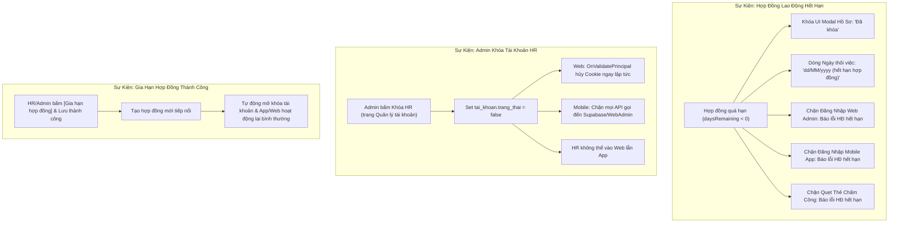

# Kế Hoạch Triển Khai Kỹ Thuật: Vòng Đời Hợp Đồng & Cơ Chế Khóa Tài Khoản Toàn Diện (Web & App)

> **Tài liệu đặc tả kỹ thuật từng bước chuẩn hóa (Phiên bản 2.0 - Lựa chọn B: Khóa Thực Tế)**  
> Phân hệ: **Nhân sự & HĐLĐ · Bảo mật & Phân quyền RBAC (Web Admin & Mobile App)**  
> Trạng thái: **Sẵn sàng thực thi (Ready for Implementation)**

---

## 🎯 1. Mục Tiêu & Cơ Chế Nghiệp Vụ Cốt Lõi

Hệ thống được thiết kế theo nguyên tắc **Zero Trust & Fail-Closed** nghiêm ngặt:
1. **Hợp đồng lao động hết hạn $\rightarrow$ Khóa THẬT cả Web lẫn App**:
   * Nhân viên (hoặc nhân sự) có hợp đồng hết hạn sẽ bị từ chối đăng nhập cả Web Admin và Mobile App.
   * Ngăn chặn quẹt thẻ chấm công, gửi đơn từ khi chưa ký kết hợp đồng mới.
2. **Admin khóa tài khoản HR $\rightarrow$ Thu hồi quyền truy cập TỨC THÌ (Real-time Session Revocation)**:
   * Khi Admin bấm "Khóa tài khoản" của HR: Phiên đăng nhập hiện tại của HR trên Web lập tức bị hủy (văng ra màn hình Login ngay ở request kế tiếp, không cần chờ hết hạn Cookie).
   * Trên Mobile App: Mọi request gửi kèm token của HR đều bị từ chối (401 Unauthorized) do hệ thống kiểm tra `account.TrangThai` trong CSDL trên từng request.
3. **Giao diện Modal & Trang HĐLĐ chuẩn hóa theo yêu cầu**:
   * Dòng *Ngày thôi việc*: `dd/MM/yyyy (hết hạn hợp đồng)`.
   * Tab *Tài khoản & RBAC*: Huy hiệu đỏ `Đã khóa`.
   * Trang HĐLĐ: Mặc định ẩn HĐ hết hạn, tại cột *Loại hợp đồng* có nút `Gia hạn hợp đồng` bật popup form lập HĐ mới.



---

## 📁 2. Danh Sách Các File Mã Nguồn Can Thiệp

| STT | File đường dẫn | Vai trò can thiệp |
| :---: | :--- | :--- |
| 1 | [Views/NhanVien/_EmployeeProfileModalContent.cshtml](file:///C:/Users/thuon/source/HTTT-DN-HRM-TheOverTimeHotel/src/OvertimeHotel.HRM.WebAdmin/Views/NhanVien/_EmployeeProfileModalContent.cshtml) | Hiển thị Ngày thôi việc `dd/MM/yyyy (hết hạn hợp đồng)` & Tab 3 `Đã khóa` |
| 2 | [Controllers/HopDongController.cs](file:///C:/Users/thuon/source/HTTT-DN-HRM-TheOverTimeHotel/src/OvertimeHotel.HRM.WebAdmin/Controllers/HopDongController.cs) | Mặc định ẩn HĐ hết hạn ở `Index`, hỗ trợ tham số gia hạn |
| 3 | [Views/HopDong/Index.cshtml](file:///C:/Users/thuon/source/HTTT-DN-HRM-TheOverTimeHotel/src/OvertimeHotel.HRM.WebAdmin/Views/HopDong/Index.cshtml) | Bộ lọc thời hạn & Script JavaScript bật Modal Lập hợp đồng mới để gia hạn |
| 4 | [Views/HopDong/_ContractTablePartial.cshtml](file:///C:/Users/thuon/source/HTTT-DN-HRM-TheOverTimeHotel/src/OvertimeHotel.HRM.WebAdmin/Views/HopDong/_ContractTablePartial.cshtml) | Nút/chữ `Gia hạn hợp đồng` tại cột **Loại hợp đồng** |
| 5 | [Controllers/AccountController.cs](file:///C:/Users/thuon/source/HTTT-DN-HRM-TheOverTimeHotel/src/OvertimeHotel.HRM.WebAdmin/Controllers/AccountController.cs) | Chặn đăng nhập Web khi HĐ hết hạn hoặc tài khoản bị Admin khóa |
| 6 | [Controllers/Api/MobileAuthController.cs](file:///C:/Users/thuon/source/HTTT-DN-HRM-TheOverTimeHotel/src/OvertimeHotel.HRM.WebAdmin/Controllers/Api/MobileAuthController.cs) | Chặn đăng nhập Mobile App khi HĐ hết hạn hoặc tài khoản bị Admin khóa |
| 7 | [Controllers/Api/AttendanceController.cs](file:///C:/Users/thuon/source/HTTT-DN-HRM-TheOverTimeHotel/src/OvertimeHotel.HRM.WebAdmin/Controllers/Api/AttendanceController.cs) | Chặn quẹt thẻ chấm công khi HĐ hết hạn |
| 8 | [Program.cs](file:///C:/Users/thuon/source/HTTT-DN-HRM-TheOverTimeHotel/src/OvertimeHotel.HRM.WebAdmin/Program.cs) | Thêm `OnValidatePrincipal` vào Cookie Auth để đá HR ra khỏi Web ngay khi Admin bấm Khóa |

---

## 🛠️ 3. Chi Tiết Kỹ Thuật Từng Bước Triển Khai

### Bước 1: Thu hồi phiên làm việc tức thì khi Admin khóa HR (`Program.cs`)
* **Vấn đề hiện tại:** Cookie đăng nhập Web có hạn 8 tiếng. Khi Admin khóa HR, nếu HR đang mở trình duyệt thì Cookie vẫn còn hạn nên HR vẫn thao tác được cho đến khi hết hạn hoặc tắt trình duyệt.
* **Giải pháp chuẩn hóa:** Bổ sung `OnValidatePrincipal` vào `AddCookie` trong `Program.cs`:
  ```csharp
  .AddCookie(CookieAuthenticationDefaults.AuthenticationScheme, options =>
  {
      options.LoginPath = "/Account/Login";
      options.LogoutPath = "/Account/Logout";
      options.AccessDeniedPath = "/Account/AccessDenied";
      options.ExpireTimeSpan = TimeSpan.FromHours(8);
      options.SlidingExpiration = true;
      options.Cookie.Name = "OverTimeHotel_HRM_Auth";
      options.Cookie.HttpOnly = true;
      options.Cookie.SameSite = SameSiteMode.Lax;
      // KIỂM TRA TRẠNG THÁI TÀI KHOẢN TỨC THÌ TRÊN TỪNG REQUEST
      options.Events = new CookieAuthenticationEvents
      {
          OnValidatePrincipal = async context =>
          {
              var userIdStr = context.Principal?.FindFirst(ClaimTypes.NameIdentifier)?.Value;
              if (int.TryParse(userIdStr, out var userId))
              {
                  var dbContext = context.HttpContext.RequestServices.GetRequiredService<AppDbContext>();
                  var account = await dbContext.TaiKhoans.AsNoTracking().FirstOrDefaultAsync(t => t.MaTaiKhoan == userId);
                  if (account == null || !account.TrangThai)
                  {
                      // Tài khoản đã bị Admin khóa -> Thu hồi phiên ngay lập tức
                      context.RejectPrincipal();
                      await context.HttpContext.SignOutAsync(CookieAuthenticationDefaults.AuthenticationScheme);
                  }
              }
          }
      };
  })
  ```
  👉 **Kết quả:** Ngay thời điểm Admin bấm "Khóa", ở cú click tiếp theo của HR trên Web Admin, HR bị đẩy ngay ra trang Login với thông báo tài khoản đã bị khóa.

---

### Bước 2: Khóa đăng nhập Web & Mobile khi HĐLĐ hết hạn

#### 2.1. Đăng nhập Web Admin (`AccountController.cs`):
Khi kiểm tra tài khoản lúc đăng nhập:
```csharp
// Kiểm tra trạng thái tài khoản
if (!account.TrangThai)
{
    ModelState.AddModelError(string.Empty, "Tài khoản của bạn đã bị tạm khóa bởi Quản trị viên.");
    return View(model);
}

// Kiểm tra hiệu lực hợp đồng lao động của nhân viên
var latestContract = await _context.HopDongs
    .AsNoTracking()
    .Where(h => h.MaNhanVien == account.MaNhanVien)
    .OrderByDescending(h => h.NgayBatDau)
    .FirstOrDefaultAsync();

var today = DateOnly.FromDateTime(DateTime.Today);
if (latestContract != null && latestContract.NgayKetThuc.HasValue && latestContract.NgayKetThuc.Value < today)
{
    ModelState.AddModelError(string.Empty, $"Hợp đồng lao động của bạn đã hết hạn vào ngày {latestContract.NgayKetThuc.Value:dd/MM/yyyy}. Tài khoản đã tạm khóa truy cập, vui lòng liên hệ phòng Nhân sự để gia hạn.");
    return View(model);
}
```

#### 2.2. Đăng nhập Mobile App (`Controllers/Api/MobileAuthController.cs`):
```csharp
// Kiểm tra HĐ hết hạn khi nhân viên đăng nhập qua Mobile API
var latestContract = await _context.HopDongs
    .AsNoTracking()
    .Where(h => h.MaNhanVien == account.MaNhanVien)
    .OrderByDescending(h => h.NgayBatDau)
    .FirstOrDefaultAsync();

var today = DateOnly.FromDateTime(DateTime.Today);
if (latestContract != null && latestContract.NgayKetThuc.HasValue && latestContract.NgayKetThuc.Value < today)
{
    return Unauthorized(new { message = $"Hợp đồng lao động của bạn đã hết hạn ngày {latestContract.NgayKetThuc.Value:dd/MM/yyyy}. Vui lòng liên hệ phòng Nhân sự để hoàn tất gia hạn trước khi tiếp tục sử dụng app." });
}
```

#### 2.3. Chặn quẹt thẻ chấm công (`Controllers/Api/AttendanceController.cs`):
Trong phương thức `CheckIn`:
```csharp
// Kiểm tra hợp đồng lao động còn hiệu lực mới cho quẹt thẻ
var activeContract = await _context.HopDongs
    .AsNoTracking()
    .Where(h => h.MaNhanVien == maNhanVien.Value)
    .OrderByDescending(h => h.NgayBatDau)
    .FirstOrDefaultAsync();

if (activeContract != null && activeContract.NgayKetThuc.HasValue && activeContract.NgayKetThuc.Value < DateOnly.FromDateTime(DateTime.Today))
{
    return BadRequest(new { message = "Hợp đồng lao động của bạn đã hết hạn. Hệ thống tạm khóa tính năng chấm công cho đến khi hợp đồng mới được kích hoạt." });
}
```

---

### Bước 3: Cập nhật giao diện Modal Hồ sơ nhân viên (`_EmployeeProfileModalContent.cshtml`)

1. **Tab 1: Hồ Sơ Cá Nhân (Dòng Ngày thôi việc):**
   ```razor
   <div class="profile-prop-row">
       <span class="text-muted">Ngày thôi việc:</span>
       @if (emp.NgayThoiViec.HasValue)
       {
           <span class="text-danger fw-semibold">@emp.NgayThoiViec.Value.ToString("dd/MM/yyyy")</span>
       }
       else if (Model.ContractState == "DA_HET_HAN" && contract?.NgayKetThuc != null)
       {
           <span class="text-danger fw-bold">
               @contract.NgayKetThuc.Value.ToString("dd/MM/yyyy") <span class="fw-normal text-muted">(hết hạn hợp đồng)</span>
           </span>
       }
       else
       {
           <span class="text-success fw-semibold">Đang công tác</span>
       }
   </div>
   ```

2. **Tab 3: Tài Khoản & RBAC:**
   ```razor
   @if (!account.TrangThai || Model.ContractState == "DA_HET_HAN")
   {
       <span class="badge bg-danger-subtle text-danger-emphasis border border-danger-subtle rounded-pill px-3 py-2">
           <i class="bi bi-lock-fill me-1"></i>Đã khóa
       </span>
   }
   else
   {
       <span class="badge bg-success-subtle text-success-emphasis border border-success-subtle rounded-pill px-3 py-2">
           <i class="bi bi-check-circle me-1"></i>Đang hoạt động
       </span>
   }
   ```
   *Tab chip bên ngoài:* Nếu `!account.TrangThai || Model.ContractState == "DA_HET_HAN"` $\rightarrow$ Hiển thị chip đỏ: `<span class="tab-chip tab-chip--danger">Đã khóa</span>`.

---

### Bước 4: Mặc định ẩn HĐ hết hạn & Nút "Gia hạn hợp đồng" tại cột Loại hợp đồng

1. **`HopDongController.cs`**:
   Mặc định khi `contractFilter` rỗng, chỉ lấy hợp đồng có `item.State != "DA_HET_HAN" && item.State != "DA_CHAM_DUT"`.
   Chỉ khi người dùng chọn `contractFilter == "DA_HET_HAN"` mới nạp các hợp đồng quá hạn.
2. **`_ContractTablePartial.cshtml`**:
   Tại cột *Loại hợp đồng*, đối với các hợp đồng đã hết hạn (hoặc sắp hết hạn):
   ```html
   <td>
       <span class="badge bg-light text-dark border px-2 py-1 rounded-pill small">@contract.LoaiHopDong</span>
       @if (item.State == "DA_HET_HAN" || (item.DaysRemaining.HasValue && item.DaysRemaining.Value <= 30))
       {
           <div class="mt-1">
               <a href="javascript:void(0)" 
                  class="text-primary fw-bold small text-decoration-none d-inline-flex align-items-center gap-1"
                  onclick="openRenewContractModal(@contract.MaNhanVien, '@(item.EmployeeName.Replace("'", "\\'"))', '@contract.LoaiHopDong', @contract.LuongCoBan, '@(contract.NgayKetThuc?.ToString("yyyy-MM-dd") ?? "")')">
                   <i class="bi bi-arrow-repeat text-warning"></i> Gia hạn hợp đồng
               </a>
           </div>
       }
   </td>
   ```
3. **`HopDong/Index.cshtml`**:
   Bổ sung hàm `openRenewContractModal(...)` trong JavaScript để mở modal `#createContractModal`, đổi tiêu đề thành *"Gia Hạn Hợp Đồng: [Tên nhân viên]"*, chọn sẵn nhân viên và gợi ý ngày bắt đầu kế tiếp.

---

## 🧪 4. Kịch Bản Kiểm Thử Toàn Diện (Acceptance Criteria)

| STT | Kịch bản kiểm thử | Kết quả mong đợi |
| :---: | :--- | :--- |
| 1 | Mở hồ sơ nhân viên hết hạn HĐ | Tab 1 hiện `dd/MM/yyyy (hết hạn hợp đồng)`. Tab 3 hiện `Đã khóa`. |
| 2 | Nhân viên hết hạn HĐ đăng nhập Web | Bị chặn, hiện thông báo: HĐ đã hết hạn vào ngày X, tài khoản bị tạm khóa. |
| 3 | Nhân viên hết hạn HĐ đăng nhập App | Bị chặn từ chối 401, yêu cầu gặp HR để gia hạn. |
| 4 | Nhân viên hết hạn HĐ quẹt thẻ chấm công | API từ chối check-in với thông báo hợp đồng hết hạn. |
| 5 | Admin vào Quản lý tài khoản bấm Khóa HR | Phiên Web của HR lập tức bị hủy ngay cú click kế tiếp, văng về trang Login. App mobile của HR cũng bị chặn 100%. |
| 6 | HR/Admin bấm `Gia hạn hợp đồng` tại cột Loại HĐ | Popup mở form lập HĐ mới với tên NV đã chọn sẵn. Khi lưu thành công, nhân viên được mở khóa tự động trên cả Web và App. |
